<div align="center">
  <a href="https://trycloudmail.com">
    <picture>
      <source media="(prefers-color-scheme: dark)" srcset="docs/images/logo-dark.svg">
      
    </picture>
  </a>
  <h1>cloudmail: business email on your own domain, in your own Cloudflare account</h1>
  <p>
    <strong>The Google Workspace and Outlook alternative for email.</strong><br>
    Mailboxes for your team and your AI agents, with AI-drafted replies. Self-hosted, and paid once.
  </p>
  <p>
    <a href="https://trycloudmail.com/pricing"></a>
    &nbsp;
    <a href="https://trycloudmail.com"></a>
  </p>
  <p>
    <a href="https://deploy.workers.cloudflare.com/?url=https://github.com/cloudmail-hq/cloudmail"></a>
  </p>
  <p>
    <a href="https://trycloudmail.com/features">Features</a> ·
    <a href="https://trycloudmail.com/pricing">Pricing</a> ·
    <a href="https://trycloudmail.com/agents">For AI agents</a> ·
    <a href="https://trycloudmail.com/deploy">Deploy</a> ·
    <a href="https://trycloudmail.com/docs">API docs</a> ·
    <a href="https://trycloudmail.com/compare">Compare</a> ·
    <a href="https://youtu.be/X7BcVZdHAk8">Video</a>
  </p>
</div>

<p align="center">
  <picture>
    <source media="(prefers-color-scheme: dark)" srcset="docs/images/inbox-demo-dark.svg">
    
  </picture>
</p>

cloudmail is a complete webmail app that you deploy into your own Cloudflare
account. Mail for your domains arrives through Cloudflare Email Routing, each
mailbox lives in its own private database, and attachments sit in your R2 bucket.
Nothing passes through our servers. The only thing the app ever sends us is the
licence check-in.


<div align="center">
  <a href="https://youtu.be/X7BcVZdHAk8">
    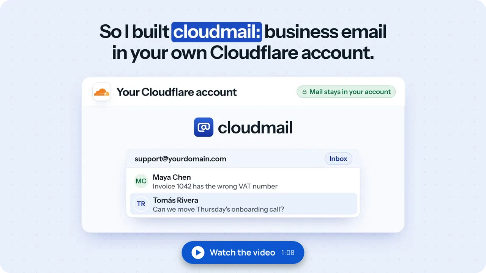
  </a>
</div>

## Why teams choose cloudmail

<table>
  <tr>
    <td width="50%" valign="top">
      <strong>You own the mail</strong><br>
      Every mailbox, attachment and search index is in your Cloudflare account. We never see your mail.
    </td>
    <td width="50%" valign="top">
      <strong>Paid once</strong><br>
      $9 or $29, once. No per-seat fee, so adding a person or an agent costs nothing.
    </td>
  </tr>
  <tr>
    <td width="50%" valign="top">
      <strong>AI is built in</strong><br>
      Summaries, triage, drafted replies and "Ask your inbox" run on Workers AI in your account, or on your own AI gateway.
    </td>
    <td width="50%" valign="top">
      <strong>Made for AI agents</strong><br>
      Every agent gets its own mailbox. Agents work through the MCP server, the CLI, the SDKs or the REST API, and their sends wait for a person's approval by default.
    </td>
  </tr>
</table>

**What it is not**

- **Not an office suite.** Email only: no calendar, contacts sync, documents, drive or video calls.
- **Not an IMAP or SMTP server.** Apple Mail, Outlook, Thunderbird and phone mail apps can't connect. Use the web app, which installs on your phone as an app with push notifications.
- **Not a hosted service.** It runs in your Cloudflare account, and you need one.

## Screenshots

<table>
  <tr>
    <td width="50%" valign="top">
      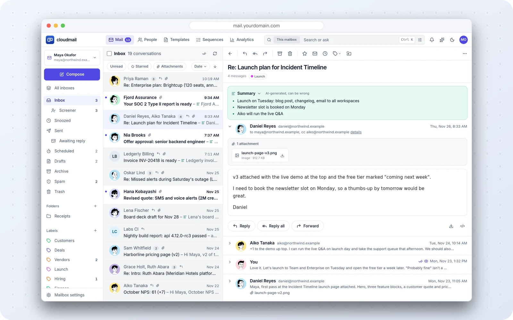
      <br><strong>Conversations with an AI summary</strong>
      <br>Threads, labels and attachments, with the summary on top.
    </td>
    <td width="50%" valign="top">
      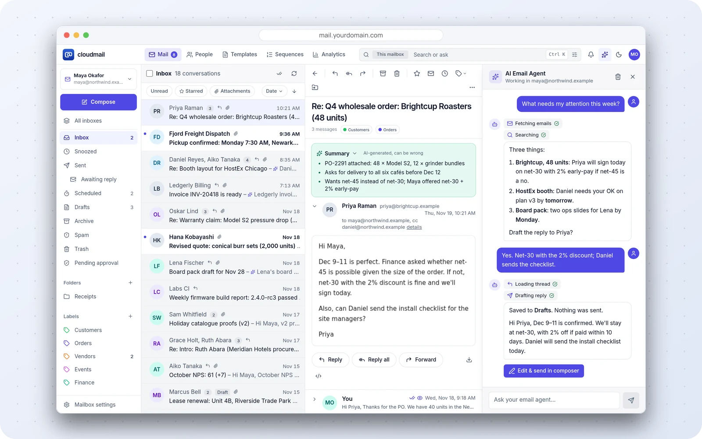
      <br><strong>An assistant that drafts replies</strong>
      <br>Ask what needs attention. It drafts, you send.
    </td>
  </tr>
  <tr>
    <td width="50%" valign="top">
      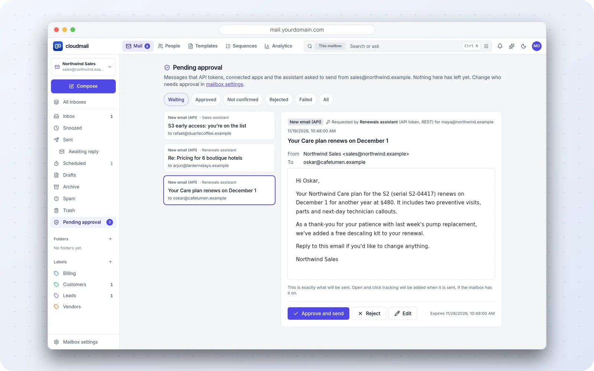
      <br><strong>Agent sends wait for approval</strong>
      <br>See exactly what an agent wants to send, then approve, edit or reject.
    </td>
    <td width="50%" valign="top">
      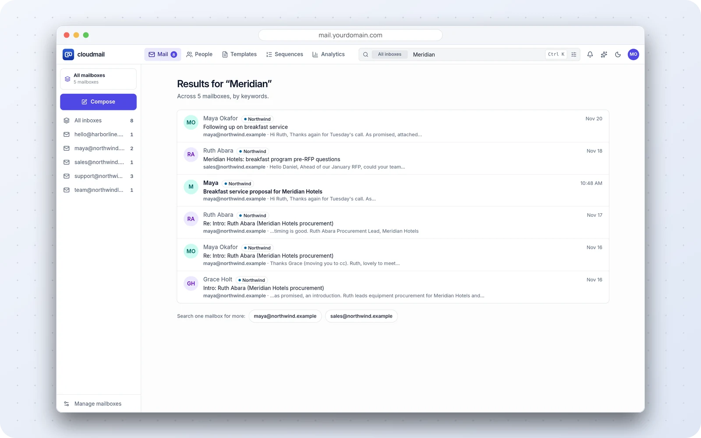
      <br><strong>Search across every mailbox</strong>
      <br>Keyword and semantic search, with operators such as <code>from:</code> and <code>has:</code>.
    </td>
  </tr>
  <tr>
    <td width="50%" valign="top">
      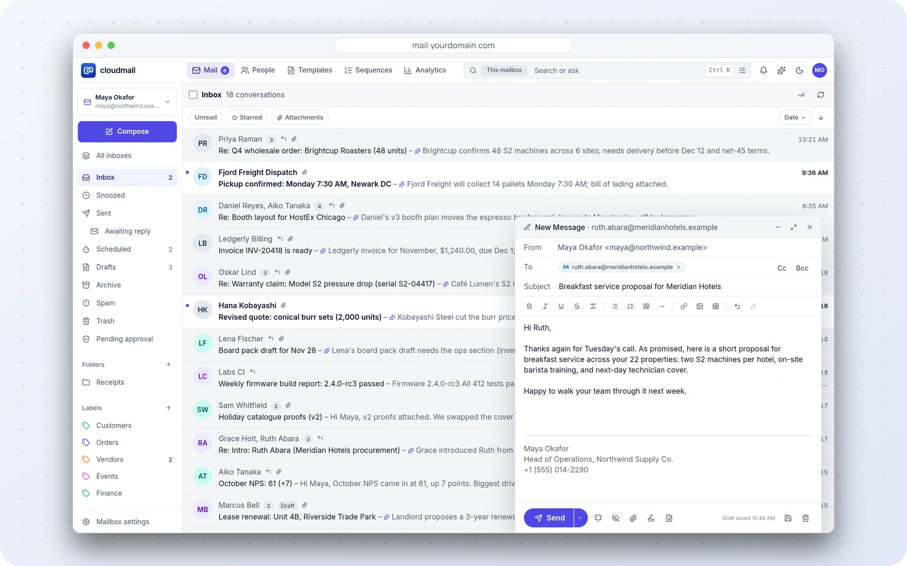
      <br><strong>A full composer</strong>
      <br>Rich text, attachments, signatures, templates and scheduled send with undo.
    </td>
    <td width="50%" valign="top">
      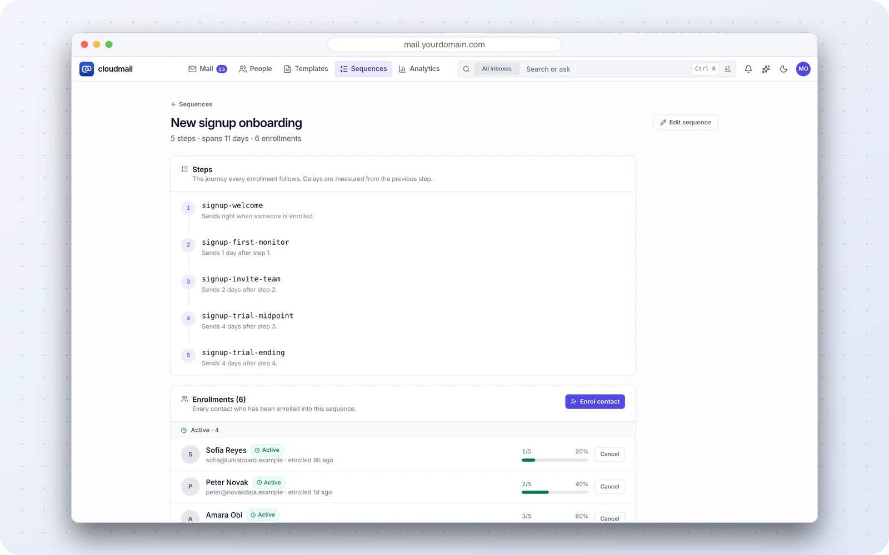
      <br><strong>Email sequences</strong>
      <br>Multi-step follow-ups with enrolments and progress.
    </td>
  </tr>
  <tr>
    <td width="50%" valign="top">
      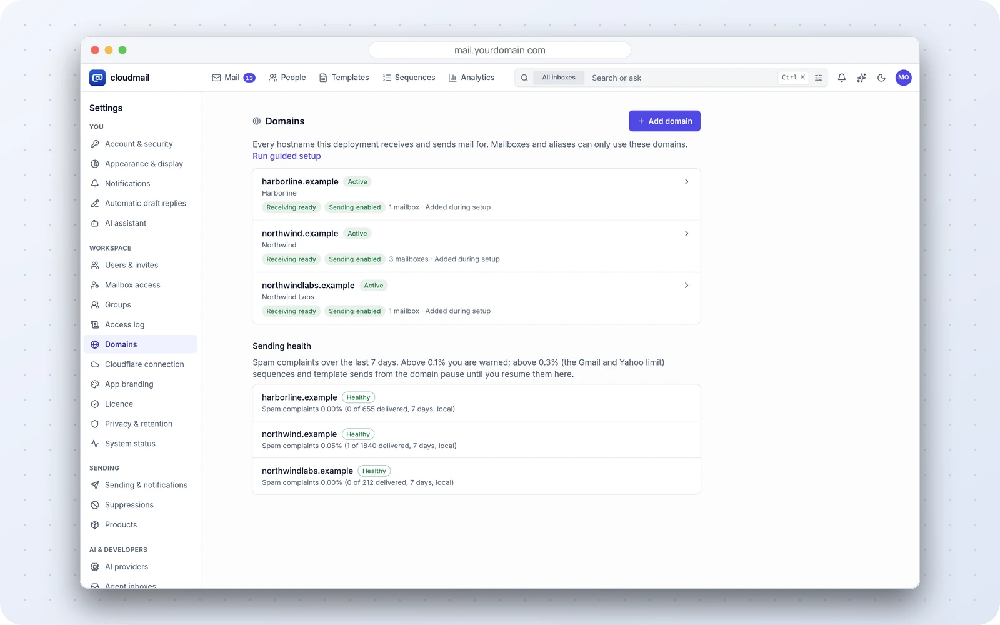
      <br><strong>All your domains in one place</strong>
      <br>Add a domain, check its DNS records and watch sending health.
    </td>
    <td width="50%" valign="top">
      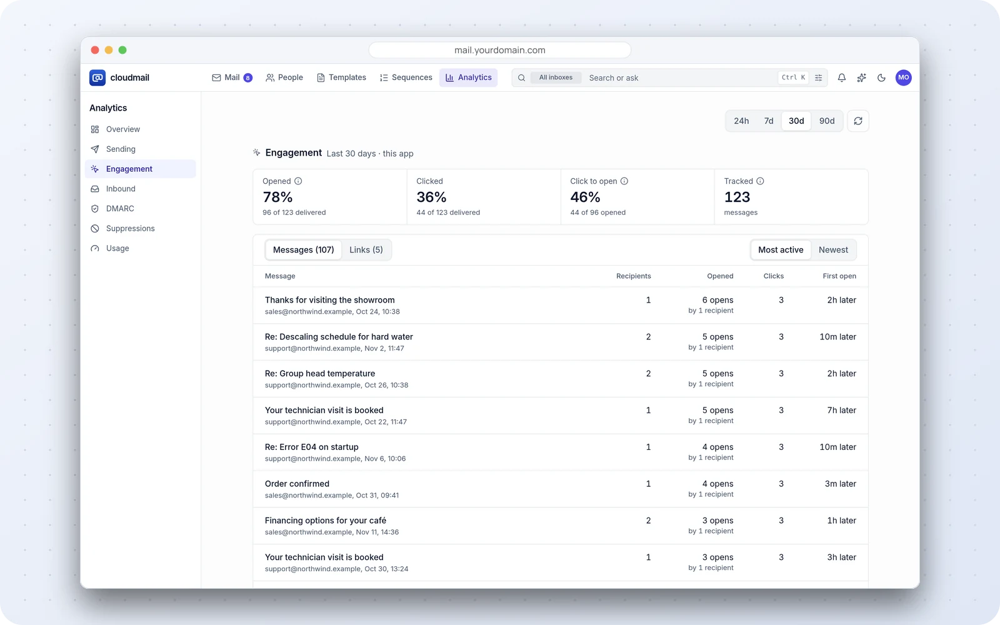
      <br><strong>Analytics</strong>
      <br>Delivery, opens, clicks, DMARC reports and usage.
    </td>
  </tr>
  <tr>
    <td width="50%" valign="top">
      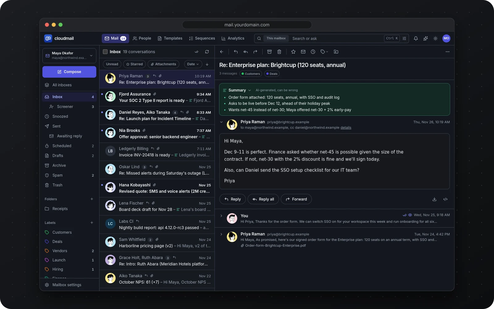
      <br><strong>Dark mode</strong>
      <br>Follows your system, or switch it yourself.
    </td>
    <td width="50%" valign="top">
      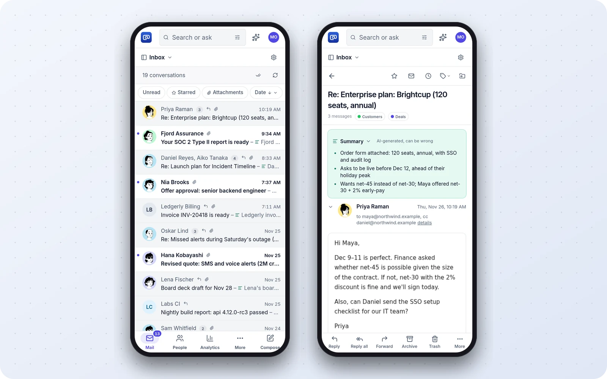
      <br><strong>On your phone</strong>
      <br>Installs as an app, with push notifications.
    </td>
  </tr>
</table>

## Features

- **[Webmail](https://trycloudmail.com/features/webmail).** Threads, folders and labels, snooze, scheduled send with a 30-second undo, search operators (`from:`, `has:`, `before:` …), bulk actions, a rich composer with attachments, inline images, signatures and templates.
- **[Email on your own domains](https://trycloudmail.com/features/custom-domain-email).** As many domains as your licence allows, unlimited mailboxes, aliases and catch-alls, live SPF, DKIM and DMARC checks, and a guided setup that shows every DNS change before making it and can undo it.
- **[Shared inboxes](https://trycloudmail.com/features/shared-inbox).** Invites, owner, admin and per-mailbox roles, delegation and an access log.
- **[AI email assistant](https://trycloudmail.com/features/ai-email-assistant).** Summaries, a daily brief, [AI triage](https://trycloudmail.com/features/ai-email-triage) with labels and a Screener, semantic search and [Ask your inbox](https://trycloudmail.com/features/ask-your-inbox), and an assistant that drafts replies. Runs on Workers AI in your account, or on [your own Anthropic- or OpenAI-compatible gateway](https://trycloudmail.com/features/bring-your-own-ai).
- **Rules and replies.** Filter rules, muted conversations, a vacation responder that won't answer mailing lists or loop with other responders, follow-up reminders.
- **[Email sequences](https://trycloudmail.com/features/email-sequences).** Multi-step follow-ups that stop when someone replies.
- **[Sending and deliverability](https://trycloudmail.com/features/email-deliverability).** Cloudflare Email Service by default, or Amazon SES or Resend per domain. Suppressions, unsubscribe headers, a spam-rate circuit breaker, optional open and click tracking.
- **[Security](https://trycloudmail.com/features/email-security).** Passwords (scrypt), passkeys, TOTP two-factor, recovery codes, Turnstile, rate limits, sandboxed message rendering with remote images blocked until you allow them.
- **[Privacy](https://trycloudmail.com/features/email-privacy).** Export everything as `.mbox`, delete an account, retention rules, tracking opt-outs.
- **[Import](https://trycloudmail.com/features/email-import).** Google Takeout `.mbox`, `.eml` archives, or IMAP from your old provider.
- **[Phone](https://trycloudmail.com/features/mobile-email-app).** Installable web app with Web Push notifications.

Every setting is described in **[docs/reference.md](docs/reference.md)**.

## Email for AI agents

<p align="center">
  
</p>

Give every agent [its own mailbox](https://trycloudmail.com/features/agent-inboxes), with its own token, send rules and expiry. Agents reach cloudmail four ways:

- **[MCP server](https://trycloudmail.com/features/email-mcp-server).** 73 tools at `https://<your-host>/mcp`, with OAuth sign-in. Works with Claude Code, Claude, Cursor, Codex, Gemini CLI and GitHub Copilot. Setup for each client: [docs/mcp.md](docs/mcp.md).
- **[CLI](cli/README.md).** The `cloudmail` command for macOS, Linux and Windows, from the [releases](https://github.com/cloudmail-hq/cloudmail/releases). Tables at a terminal, JSON in a pipe.
- **SDKs.** [TypeScript](sdk/typescript/README.md) and [Python](sdk/python/README.md) clients in this repository, typed from the API's OpenAPI document.
- **[REST API](https://trycloudmail.com/features/email-api) and webhooks.** Idempotency keys, realtime events and signed webhooks. Reference: [trycloudmail.com/docs](https://trycloudmail.com/docs).

Connect Claude Code to your mailbox:

```bash
claude mcp add --transport http cloudmail https://mail.example.com/mcp
```

Send from code with the TypeScript SDK, and handle a send that is waiting for approval:

```ts
import { Cloudmail, isPendingApproval } from "@cloudmail/sdk";

const mail = new Cloudmail({ baseUrl: "https://mail.example.com", token: process.env.CLOUDMAIL_TOKEN! });

const result = await mail.mail.send("support@example.com", {
  to: "customer@example.org",
  subject: "Your order shipped",
  markdown: "It's on the way. **Tracking:** [ZX123](https://example.com/t/ZX123)",
});
if (isPendingApproval(result)) console.log("held:", result.approval_url);
```

[Sends from agents and API tokens wait for a person's approval](https://trycloudmail.com/features/agent-send-approval) by default, and an agent can't approve its own send.

## cloudmail vs Google Workspace and Microsoft 365

| | cloudmail | Google Workspace | Microsoft 365 |
| --- | --- | --- | --- |
| Where your mail is stored | Your Cloudflare account | Google's data centres | Microsoft's data centres |
| How you pay | $9 or $29 once, plus about $5 a month to Cloudflare for the whole account | Per person, per month | Per person, per month |
| Mail on your own domains | Yes | Yes | Yes |
| Shared inboxes | Shared mailboxes with roles | Google Groups and delegation | Shared mailboxes |
| AI | Built in, on Workers AI in your account or your own gateway | Gemini, depending on plan | Copilot, depending on plan and add-ons |
| Mailboxes for AI agents | A separate address per agent, with its own token and send rules | A paid seat per agent, or API access to a person's mailbox | A user or shared mailbox through Microsoft Graph |
| Access for AI agents | MCP server, Agent Skill, CLI, SDKs and REST | Gmail API | Microsoft Graph API |
| Calendar, documents, calls | No, email only | Yes | Yes |
| IMAP and SMTP apps | No, web app only | Yes | Yes |
| Source code | Fair source, public | Proprietary | Proprietary |
| Who runs it | You | Google | Microsoft |

Full comparisons: [Google Workspace](https://trycloudmail.com/compare/google-workspace), [Microsoft 365 and Outlook](https://trycloudmail.com/compare/microsoft-365), [Fastmail](https://trycloudmail.com/compare/fastmail), [Proton Mail](https://trycloudmail.com/compare/proton-mail), [Front](https://trycloudmail.com/compare/front), [Help Scout](https://trycloudmail.com/compare/help-scout), [Missive](https://trycloudmail.com/compare/missive), [AgentMail](https://trycloudmail.com/compare/agentmail) and [Mailcow](https://trycloudmail.com/compare/mailcow).

## Deploy

[](https://deploy.workers.cloudflare.com/?url=https://github.com/cloudmail-hq/cloudmail)

<table>
  <tr>
    <td width="50%" valign="top" align="center">
      <picture>
        <source media="(prefers-color-scheme: dark)" srcset="docs/images/deploy-demo-dark.svg">
        
      </picture>
      <br><strong>One click to deploy</strong>
    </td>
    <td width="50%" valign="top" align="center">
      <picture>
        <source media="(prefers-color-scheme: dark)" srcset="docs/images/domains-demo-dark.svg">
        
      </picture>
      <br><strong>Add a domain, verify its DNS</strong>
    </td>
  </tr>
</table>

One click to deploy, then a guided setup in the app:

1. **Deploy.** The button copies this repository to your GitHub or GitLab account and creates the Worker, R2 bucket, KV namespace, Vectorize index, Durable Objects and Workers AI binding. Keep the suggested names. Fill `SETUP_TOKEN` and `AUTH_SECRET` with the output of `openssl rand -base64 32` each, and keep the setup token in a password manager. Leave the rest empty.
2. **Create the owner.** Open the new `workers.dev` address. It goes to `/setup`, where the setup token creates your owner account.
3. **Connect Cloudflare and activate your licence.** Press **Create token**: the Cloudflare dashboard opens with the right permissions filled in. Paste the token back, then paste your [licence key](#pricing).
4. **Review and apply.** Pick your domains. The app shows a plan: what it will do itself (turn on Email Routing, point the catch-all at this Worker, set up sending, add a monitor-only DMARC record), what needs your OK (anything that changes a record you already have, such as another provider's MX), and anything you must do by hand. Apply it, create a mailbox, and send it a test.

Before you start, turn on R2 once in the dashboard, and if another provider handles mail for the domain today, move your old mail first. The full guide, including a command-line deploy and a prompt for AI agents, is in **[docs/self-deploy.md](docs/self-deploy.md)**. Problems: **[docs/troubleshooting.md](docs/troubleshooting.md)**.

### Deploy with an AI agent

Paste this into an AI agent that has terminal access (Claude Code, Codex, Cursor and similar):

```text
Install cloudmail from https://github.com/cloudmail-hq/cloudmail on my Cloudflare account.

1. Read README.md, docs/self-deploy.md and wrangler.jsonc first.
2. Ask me for my Cloudflare account ID and a deploy API token, using a secret input.
   Use them only as CLOUDFLARE_ACCOUNT_ID and CLOUDFLARE_API_TOKEN for Wrangler.
   Never print them, commit them, write them to a tracked file, or pass them as
   command arguments.
3. Keep the Worker name exactly "cloudmail". Create the Vectorize index
   "cloudmail-semantic" if it does not exist:
   npx wrangler vectorize create cloudmail-semantic --dimensions=1024 --metric=cosine
4. Run `npm ci`, then `npm run deploy` (it also creates the R2 bucket, the KV
   namespace and the Vectorize metadata index), then `npm run secrets -- --deploy`
   to upload SETUP_TOKEN and AUTH_SECRET. Tell me the setup token it prints, once.
5. Give me the app URL. I will open /setup, create the owner account, connect
   my Cloudflare token and activate my licence in the app.
```

The deploy token needs **Workers Scripts Edit**, **Workers R2 Storage Edit**, **Workers KV Storage Edit**, **Vectorize Edit** and **Account Settings Read** on the target account. It is separate from the token you paste into the app.

## Pricing

cloudmail is fair source: the code is public, and running it needs a licence key, paid once.

| | Solo | Unlimited |
| --- | --- | --- |
| Price | **$9** once | **$29** once |
| Domains | 1 | Unlimited |
| Deployments | 1 | 1 |
| Mailboxes and users | Unlimited | Unlimited |
| Updates | All 1.x releases | All 1.x releases |
| | [**Buy Solo**](https://licence.tapetide.com/cloudmail/buy/solo) | [**Buy Unlimited**](https://licence.tapetide.com/cloudmail/buy/unlimited) |

Payments are handled by Dodo Payments. The key arrives by email. See [Licence](#licence).

<p align="center">
  <a href="https://trycloudmail.com/pricing"></a>
</p>

## Cost and plan requirements

cloudmail has no monthly fee from us. Cloudflare bills your account directly.

**The usual setup costs about $5 a month to Cloudflare for the whole account, not per user:** the [Workers Paid plan](https://developers.cloudflare.com/workers/platform/pricing/), which includes 3,000 sent emails a month, then $0.35 per 1,000 ([Email Service pricing](https://developers.cloudflare.com/email-service/platform/pricing/)).

Can it run on the Workers Free plan? Partly. We deployed it on a new Free account (November 2026) and this is what we found:

| | Workers Free | Workers Paid |
| --- | --- | --- |
| Deploy (Worker, 7 SQLite Durable Objects, R2, KV, Vectorize + metadata index, rate limits, cron) | Works | Works |
| Receiving mail (Email Routing to the Worker) | Works, unlimited | Works, unlimited |
| Sending through **Cloudflare Email Sending** | **No.** Only to your own verified addresses. Mail to anyone else fails with `E_RECIPIENT_NOT_ALLOWED` | Any recipient. 3,000 a month included |
| Sending through your own **Resend** or **Amazon SES** account | Works (tested). Their own pricing applies; Resend's free tier is 100 a day | Works |
| CPU per request | 10 ms documented. Creating the owner used ~200 ms and a sign-in ~110 ms and both succeeded, but Cloudflare can enforce the limit; large messages and AI work need more | Up to 5 minutes |
| Daily caps | 100,000 requests, 100,000 Durable Object requests and rows written, 10,000 Workers AI neurons. Over them, requests fail until 00:00 UTC | Billed by use beyond generous monthly allowances |
| R2 | 10 GB free, but R2 must be turned on in the dashboard, which can ask for a payment method | Same |

So **Free + Resend or SES** can work for one person with light mail. For a team, or to use Cloudflare's own sending, plan on Workers Paid. Sources: [Workers limits](https://developers.cloudflare.com/workers/platform/limits/), [Email Service pricing](https://developers.cloudflare.com/email-service/platform/pricing/), [Durable Objects pricing](https://developers.cloudflare.com/durable-objects/platform/pricing/), [Workers AI pricing](https://developers.cloudflare.com/workers-ai/platform/pricing/), [Vectorize pricing](https://developers.cloudflare.com/vectorize/platform/pricing/), [R2 pricing](https://developers.cloudflare.com/r2/pricing/).

You also need a domain on Cloudflare DNS (Cloudflare limits Email Routing to 200 rules per domain; the catch-all avoids per-address rules).

## Architecture

```
 Internet mail ──> Cloudflare Email Routing ──catch-all──┐
                                                          v
 Browser / phone ───────────────────────────────> cloudmail Worker (Hono API + React Router SSR)
 CLI, SDKs, MCP clients ──────────────────────────>   │
                                                       ├─> MailboxDO        one SQLite database per mailbox
                                                       ├─> AuthDO           accounts, sessions, tokens, domains, licence
                                                       ├─> EmailAgent DO    the assistant (Agents SDK)
                                                       ├─> WebhookDO, EventsDO, AssistantDO, EmailMCP
                                                       ├─> R2               raw messages, attachments, exports
                                                       ├─> Vectorize        semantic search (one namespace per mailbox)
                                                       ├─> Workers AI       summaries, triage, embeddings
                                                       └─> Email Service / Amazon SES / Resend  ──> outbound mail
```

- **Your account, your data.** Every resource above is in your Cloudflare account. Mailboxes are isolated from each other at the storage level.
- **Stack.** React 19, React Router 7, Tailwind CSS 4, TanStack Query, TipTap on the front; Hono, Durable Objects (SQLite), R2, KV, Vectorize, Workers AI and the Agents SDK on the Worker.
- **Licence check-in.** The only call to us: the key once at activation, then a daily refresh that sends the deployment id, host name and Cloudflare account id. See [Licence](#licence).

## Upgrade, back up, uninstall

- **Upgrade.** Pull the new release into your copy of the repository and push; Workers Builds redeploys. Data migrations run by themselves. Step by step, including what to check in `wrangler.jsonc`: [docs/upgrade.md](docs/upgrade.md).
- **Back up.** Settings → Account & security → Your data → **Export** gives a zip with one `.mbox` per mailbox (every mailbox, for an admin). Do it before upgrades and on a schedule. [Details](docs/upgrade.md#back-up).
- **Uninstall.** Point your domain's mail elsewhere first, export, deactivate the licence, then delete the Worker, bucket, KV namespace and index. [Checklist](docs/upgrade.md#uninstall).

## Security

- Sign-in is built in: scrypt password hashes, passkeys, TOTP two-factor with recovery codes, per-account lockout and rate limits, optional Turnstile. Secrets (2FA, stored tokens, import passwords) are encrypted at rest under `AUTH_SECRET`.
- Message bodies are sanitised and rendered in a sandboxed frame. Remote images are fetched through a signed proxy only after you allow them.
- Agent and API-token sends are held for a person's approval by default, and an agent credential can't approve its own send.
- The full model, including the authorization rules and inbound-mail trust, is in [docs/reference.md](docs/reference.md#security-model). An incident checklist for operators is in [docs/security/breach-runbook.md](docs/security/breach-runbook.md).

**Reporting a vulnerability.** Please don't open a public issue. Use GitHub's **Report a vulnerability** button on the [Security tab](https://github.com/cloudmail-hq/cloudmail/security), or email security@trycloudmail.com. We reply within three working days and credit reporters who want it.

## Questions

**Is cloudmail a Google Workspace or Microsoft 365 alternative?** For email, yes: mailboxes on your own domains, shared inboxes, search and a phone app. It has no calendar, documents or calls.

**Where is my mail stored?** In your Cloudflare account: one database per mailbox, and attachments in your R2 bucket.

**What does it cost to run?** The licence is $9 or $29 once. Cloudflare bills you about $5 a month for the whole account, however many people use it. See [Cost and plan requirements](#cost-and-plan-requirements).

**Can I read my mail in Outlook or Apple Mail?** No. cloudmail has no IMAP or SMTP server. Use the web app on a computer, and install it on your phone.

**Can an AI agent send email by itself?** Only if you allow it. By default every agent send waits for a person. An agent mailbox can send on its own to the recipients you allow.

**Can I move my old mail in?** Yes: from Google Takeout, `.mbox` and `.eml` files, or over IMAP from your current provider.

## Support

- **Website:** [trycloudmail.com](https://trycloudmail.com), with the [feature tour](https://trycloudmail.com/features), [pricing](https://trycloudmail.com/pricing) and [API docs](https://trycloudmail.com/docs).
- **Docs:** [self-deploy](docs/self-deploy.md), [troubleshooting](docs/troubleshooting.md), [upgrade](docs/upgrade.md), [reference](docs/reference.md).
- **Bugs:** [GitHub issues](https://github.com/cloudmail-hq/cloudmail/issues). Never paste tokens, keys or licence keys there.
- **Questions and ideas:** [GitHub discussions](https://github.com/cloudmail-hq/cloudmail/discussions). The [roadmap](https://github.com/cloudmail-hq/cloudmail/discussions/1) is there too.
- **Contributing:** [CONTRIBUTING.md](https://github.com/cloudmail-hq/cloudmail/blob/main/CONTRIBUTING.md) shows how to run cloudmail on your computer without a Cloudflare account or a licence key. Start with a [good first issue](https://github.com/cloudmail-hq/cloudmail/issues?q=is%3Aissue+is%3Aopen+label%3A%22good+first+issue%22). Your first merged pull request earns a free Unlimited licence.
- **Licence and purchase help:** support@trycloudmail.com, with your order email.

## Licence

cloudmail is fair source, under the [Fair Core License](LICENSE):

- The code is public. You can read it, change it and run it for your own use.
- Running it needs a licence key ([pricing](#pricing)). The key covers one deployment; Solo is licensed for one domain, Unlimited for any number.
- The licence does not allow removing or bypassing the licence key check, or offering cloudmail to others as a competing product or service.
- Each release becomes open source, under Apache 2.0, two years after it ships.

### How the licence check works

- **Activation.** An administrator pastes the licence key in the onboarding wizard (after **Connect Cloudflare**) or at **Settings → Licence**. The app sends the key once to the licence server, together with this deployment's id, its host name and the connected Cloudflare account id. It gets back a signed token bound to this deployment and host. Only the token is stored, in the auth Durable Object. The key is never stored or logged.
- **Checks.** The app verifies the token offline against public keys bundled in `shared/licence-keys.ts`, and never fetches keys at runtime. The 5-minute cron refreshes it once a day, as does the first request after `refresh_after`. A token is valid for 30 days and is extended at each refresh. That is a check-in, not a renewal: there is nothing to pay again.
- **When a check fails.** The app keeps working. Once the token is past its expiry, admins see a banner: "Licence couldn't be renewed, N days left". After 7 more days, or at once if the licence is revoked (a refund, a lost dispute, or deactivation), the app locks.
- **When locked:**
  - The UI shows one "Activate your licence" screen: a key field for admins, "Ask your admin" for everyone else. API, MCP and token calls answer 402 `licence_required`.
  - Incoming mail is **always received and stored**, so nothing bounces. Forwarding, auto-replies, AI triage, push notifications and webhooks pause.
  - Sending stops. Scheduled sends that come due are held and go out after activation, and sequence steps stay pending.
  - Recipient-facing links keep working: unsubscribe, tracking, the privacy page and product logos.
  - Password reset still works, so an admin can always sign in to activate.
- **Moving or freeing a slot.** **Settings → Licence → Deactivate** (with the key) frees this deployment's slot at the licence server, and the deployment locks.
- **Building from source.** The check is part of every build, and no setting turns it off.


### Licence and trademarks

cloudmail is licensed under the Fair Core License, version 1.0, with Apache 2.0 as its future licence (FCL-1.0-ALv2); see [LICENSE](LICENSE). Third-party licence texts are in [LICENSES/](LICENSES/Apache-2.0.txt).

cloudmail is not affiliated with, endorsed by or sponsored by Cloudflare, Google or Microsoft. Cloudflare is a trademark of Cloudflare, Inc. Google Workspace is a trademark of Google LLC. Microsoft 365 and Outlook are trademarks of Microsoft Corporation.

<div align="center">
  <h3>Run your company's email in your own Cloudflare account</h3>
  <p>
    <a href="https://trycloudmail.com/pricing"></a>
    &nbsp;
    <a href="https://trycloudmail.com"></a>
  </p>
</div>
