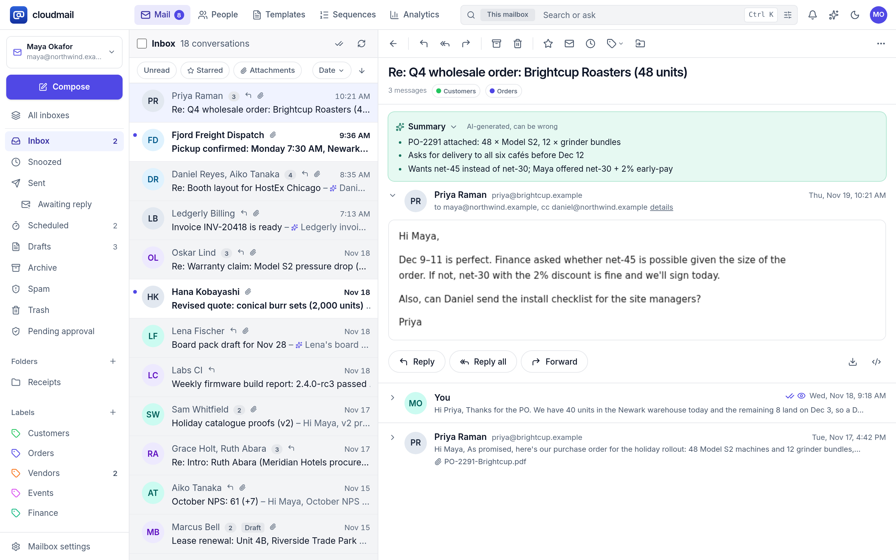
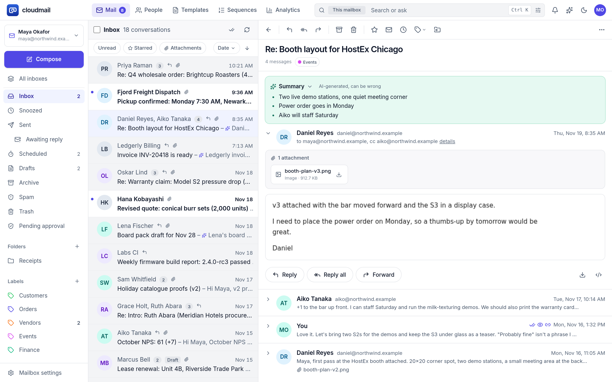
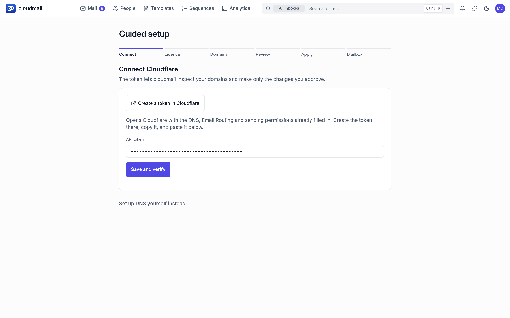
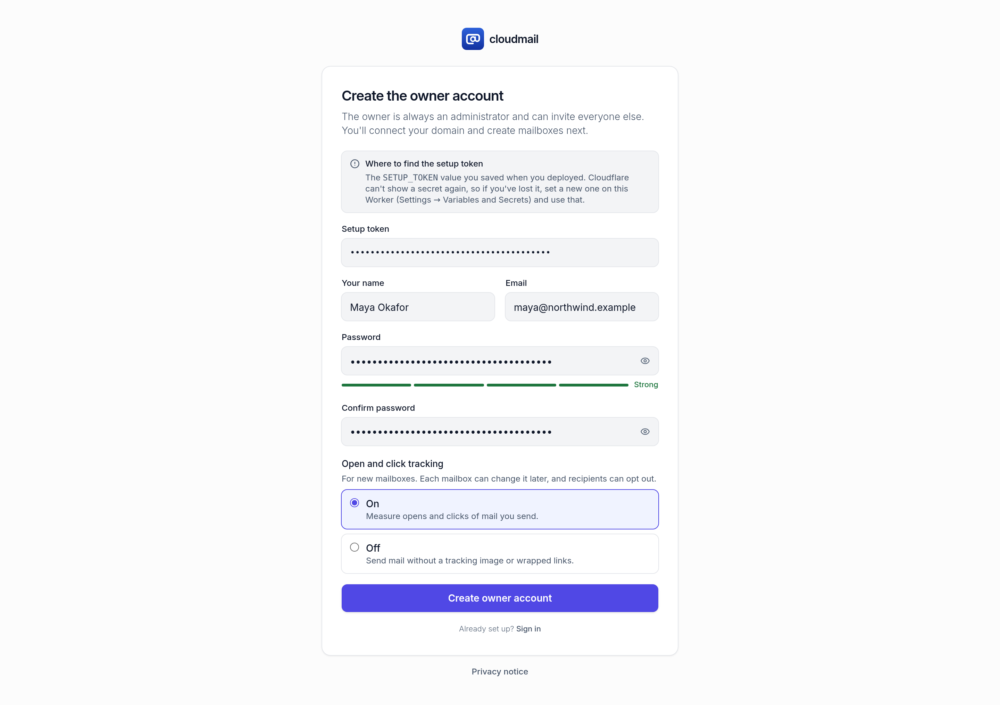
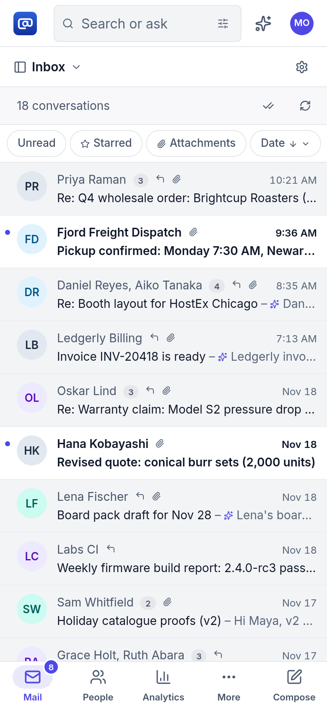
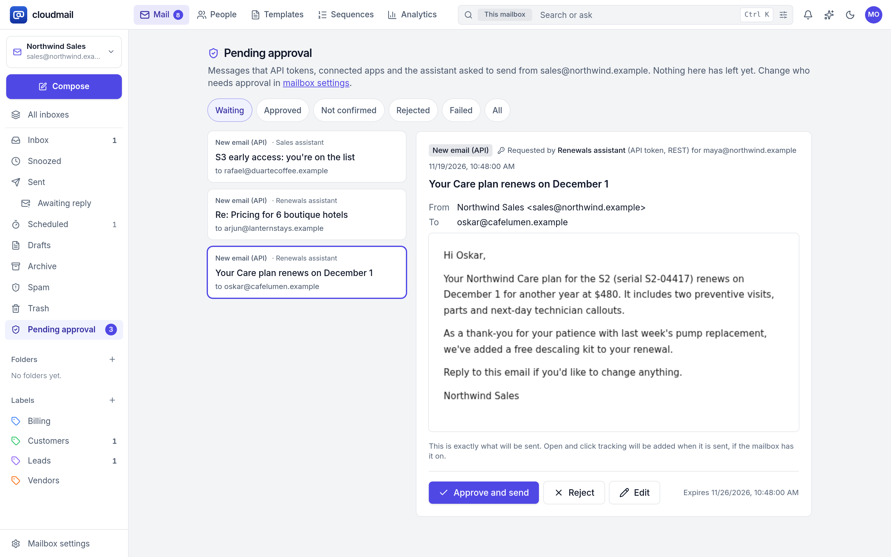

<div align="center">
  <h1>cloudmail</h1>
  <p><strong>Business email on your own domain, on your own Cloudflare account.</strong></p>
  <p>An alternative to Google Workspace and Microsoft 365 <em>for email</em>. Pay once, no per-seat fees.</p>
</div>



cloudmail is a complete webmail app that you deploy into your own Cloudflare
account. Mail for your domains arrives through Cloudflare Email Routing, each
mailbox lives in its own Durable Object (a private SQLite database), and
attachments sit in your R2 bucket. Nothing passes through our servers. The only
thing the app ever sends us is the licence check-in.


**What it is**

- Webmail for you and your team: threads, labels, search, snooze, scheduled send with undo, rules, vacation replies, templates, signatures.
- Unlimited mailboxes, aliases and catch-alls on your domains. Shared inboxes with per-mailbox roles, two-factor sign-in and passkeys, an access log.
- AI triage, summaries and draft replies on Workers AI in your own account, or on a gateway you choose.
- Built for agents too: an MCP server, a CLI, TypeScript and Python SDKs, webhooks and a REST API. Sends from agents and API tokens wait for your approval by default.

**What it is not**

- **Not an office suite.** Mail only: no calendar, contacts sync, documents, drive or video calls.
- **Not an IMAP or SMTP server.** Apple Mail, Outlook, Thunderbird and phone mail apps can't connect. Use the web app, which installs on your phone as an app with push notifications.
- **Not a hosted service.** It runs in your Cloudflare account, and you need one.

## Screenshots

| | |
| --- | --- |
|  |  |
|  |  |
|  | |

## Deploy

[](https://deploy.workers.cloudflare.com/?url=https://github.com/cloudmail-hq/cloudmail)

One click to deploy, then a guided setup in the app:

1. **Deploy.** The button copies this repository to your GitHub or GitLab account and creates the Worker, R2 bucket, KV namespace, Vectorize index, Durable Objects and Workers AI binding. Keep the suggested names. Fill `SETUP_TOKEN` and `AUTH_SECRET` with the output of `openssl rand -base64 32` each, and keep the setup token in a password manager. Leave the rest empty.
2. **Create the owner.** Open the new `workers.dev` address. It goes to `/setup`, where the setup token creates your owner account.
3. **Connect Cloudflare and activate your licence.** Press **Create token**: the Cloudflare dashboard opens with the right permissions filled in. Paste the token back, then paste your licence key.
4. **Review and apply.** Pick your domains. The app shows a plan: what it will do itself (turn on Email Routing, point the catch-all at this Worker, set up sending, add a monitor-only DMARC record), what needs your OK (anything that changes a record you already have, such as another provider's MX), and anything you must do by hand. Apply it, create a mailbox, and send it a test.

Before you start, turn on R2 once in the dashboard, and if another provider handles mail for the domain today, move your old mail first. The full guide, including a command-line deploy and a prompt for AI agents, is in **[docs/self-deploy.md](docs/self-deploy.md)**. Problems: **[docs/troubleshooting.md](docs/troubleshooting.md)**.

### Deploy with an AI agent

Paste this into an AI agent that has terminal access (Claude Code, Codex, Cursor and similar):

```text
Install cloudmail from https://github.com/cloudmail-hq/cloudmail on my Cloudflare account.

1. Read README.md, docs/self-deploy.md and wrangler.jsonc first.
2. Ask me for my Cloudflare account ID and a deploy API token, using a secret input.
   Use them only as CLOUDFLARE_ACCOUNT_ID and CLOUDFLARE_API_TOKEN for Wrangler.
   Never print them, commit them, write them to a tracked file, or pass them as
   command arguments.
3. Keep the Worker name exactly "cloudmail". Create the Vectorize index
   "cloudmail-semantic" if it does not exist:
   npx wrangler vectorize create cloudmail-semantic --dimensions=1024 --metric=cosine
4. Run `npm ci`, then `npm run deploy` (it also creates the R2 bucket, the KV
   namespace and the Vectorize metadata index), then `npm run secrets -- --deploy`
   to upload SETUP_TOKEN and AUTH_SECRET. Tell me the setup token it prints, once.
5. Give me the app URL. I will open /setup, create the owner account, connect
   my Cloudflare token and activate my licence in the app.
```

The deploy token needs **Workers Scripts Edit**, **Workers R2 Storage Edit**, **Workers KV Storage Edit**, **Vectorize Edit** and **Account Settings Read** on the target account. It is separate from the token you paste into the app.

## Pricing

cloudmail is open source under Apache-2.0. The official build asks for a licence key, paid once:

| | Solo | Unlimited |
| --- | --- | --- |
| Price | **$9** once | **$29** once |
| Domains | 1 | Unlimited |
| Deployments | 1 | 1 |
| Mailboxes and users | Unlimited | Unlimited |
| Updates | All 1.x releases | All 1.x releases |
| | [Buy Solo](https://licence.tapetide.com/cloudmail/buy/solo) | [Buy Unlimited](https://licence.tapetide.com/cloudmail/buy/unlimited) |

Payments are handled by Dodo Payments. The key arrives by email. If you build it yourself you are free to switch the check off; buying the key is how you get the one-click setup, updates and support, and how the project is funded. See [Licence](#licence).

## Cost and plan requirements

cloudmail has no monthly fee from us. Cloudflare bills your account directly.

**The usual setup costs about $5 a month to Cloudflare for the whole account, not per user:** the [Workers Paid plan](https://developers.cloudflare.com/workers/platform/pricing/), which includes 3,000 sent emails a month, then $0.35 per 1,000 ([Email Service pricing](https://developers.cloudflare.com/email-service/platform/pricing/)).

Can it run on the Workers Free plan? Partly. We deployed it from scratch on a Free account (November 2026) and this is what we found:

| | Workers Free | Workers Paid |
| --- | --- | --- |
| Deploy (Worker, 7 SQLite Durable Objects, R2, KV, Vectorize + metadata index, rate limits, cron) | Works | Works |
| Receiving mail (Email Routing to the Worker) | Works, unlimited | Works, unlimited |
| Sending through **Cloudflare Email Sending** | **No.** Only to your own verified addresses. Mail to anyone else fails with `E_RECIPIENT_NOT_ALLOWED` | Any recipient. 3,000 a month included |
| Sending through your own **Resend** or **Amazon SES** account | Works (tested). Their own pricing applies; Resend's free tier is 100 a day | Works |
| CPU per request | 10 ms documented. Creating the owner used ~200 ms and a sign-in ~110 ms and both succeeded, but Cloudflare can enforce the limit; large messages and AI work need more | Up to 5 minutes |
| Daily caps | 100,000 requests, 100,000 Durable Object requests and rows written, 10,000 Workers AI neurons. Over them, requests fail until 00:00 UTC | Billed by use beyond generous monthly allowances |
| R2 | 10 GB free, but R2 must be turned on in the dashboard, which can ask for a payment method | Same |

So **Free + Resend or SES** can work for one person with light mail. For a team, or to use Cloudflare's own sending, plan on Workers Paid. Sources: [Workers limits](https://developers.cloudflare.com/workers/platform/limits/), [Email Service pricing](https://developers.cloudflare.com/email-service/platform/pricing/), [Durable Objects pricing](https://developers.cloudflare.com/durable-objects/platform/pricing/), [Workers AI pricing](https://developers.cloudflare.com/workers-ai/platform/pricing/), [Vectorize pricing](https://developers.cloudflare.com/vectorize/platform/pricing/), [R2 pricing](https://developers.cloudflare.com/r2/pricing/).

You also need a domain on Cloudflare DNS (Cloudflare limits Email Routing to 200 rules per domain; the catch-all avoids per-address rules).

## Features

- **A real mail client.** Threads, folders and labels, snooze, scheduled send with a 30-second undo, search operators (`from:`, `has:`, `before:` …), bulk actions, a rich composer with attachments, inline images, signatures and templates.
- **Rules and replies.** Filter rules, muted conversations, a vacation responder that won't answer mailing lists or loop with other responders, follow-up reminders.
- **Teams.** Invites, owner, admin and per-mailbox roles, delegation, shared inboxes, an access log.
- **Domains.** As many domains as your licence allows, aliases and catch-all mailboxes, live SPF, DKIM and DMARC checks, and a guided setup that shows every DNS change before making it and can undo it.
- **Sending.** Cloudflare Email Service by default, or Amazon SES or Resend per domain. Suppressions, unsubscribe headers, a spam-rate circuit breaker, optional open and click tracking.
- **Security.** Passwords (scrypt), passkeys, TOTP two-factor, recovery codes, Turnstile, rate limits, sandboxed message rendering with remote images blocked until you allow them.
- **Privacy.** Export everything as `.mbox`, delete an account, retention rules, tracking opt-outs.
- **Import.** Google Takeout `.mbox`, `.eml` archives, or IMAP from your old provider.
- **AI.** Summaries, a daily brief, AI labels and a Screener, semantic search and "Ask my inbox", an assistant that drafts replies. Runs on Workers AI in your account, or on your own Anthropic- or OpenAI-compatible gateway.
- **For agents and code.** MCP server with OAuth sign-in, the `cloudmail` CLI, TypeScript and Python SDKs, REST with idempotency keys, webhooks, realtime events, agent inboxes. Agent sends wait for approval by default.
- **Phone.** Installable web app with Web Push notifications.

Every setting is described in **[docs/reference.md](docs/reference.md)**.

## Architecture

```
 Internet mail ──> Cloudflare Email Routing ──catch-all──┐
                                                          v
 Browser / phone ───────────────────────────────> cloudmail Worker (Hono API + React Router SSR)
 CLI, SDKs, MCP clients ──────────────────────────>   │
                                                       ├─> MailboxDO        one SQLite database per mailbox
                                                       ├─> AuthDO           accounts, sessions, tokens, domains, licence
                                                       ├─> EmailAgent DO    the assistant (Agents SDK)
                                                       ├─> WebhookDO, EventsDO, AssistantDO, EmailMCP
                                                       ├─> R2               raw messages, attachments, exports
                                                       ├─> Vectorize        semantic search (one namespace per mailbox)
                                                       ├─> Workers AI       summaries, triage, embeddings
                                                       └─> Email Service / Amazon SES / Resend  ──> outbound mail
```

- **Your account, your data.** Every resource above is in your Cloudflare account. Mailboxes are isolated from each other at the storage level.
- **Stack.** React 19, React Router 7, Tailwind CSS 4, TanStack Query, TipTap on the front; Hono, Durable Objects (SQLite), R2, KV, Vectorize, Workers AI and the Agents SDK on the Worker.
- **Licence check-in.** The only call to us: the key once at activation, then a daily refresh that sends the deployment id, host name and Cloudflare account id. See [Licence](#licence).

## Upgrade, back up, uninstall

- **Upgrade.** Pull the new release into your copy of the repository and push; Workers Builds redeploys. Data migrations run by themselves. Step by step, including what to check in `wrangler.jsonc`: [docs/upgrade.md](docs/upgrade.md).
- **Back up.** Settings → Account & security → Your data → **Export** gives a zip with one `.mbox` per mailbox (every mailbox, for an admin). Do it before upgrades and on a schedule. [Details](docs/upgrade.md#back-up).
- **Uninstall.** Point your domain's mail elsewhere first, export, deactivate the licence, then delete the Worker, bucket, KV namespace and index. [Checklist](docs/upgrade.md#uninstall).

## Security

- Sign-in is built in: scrypt password hashes, passkeys, TOTP two-factor with recovery codes, per-account lockout and rate limits, optional Turnstile. Secrets (2FA, stored tokens, import passwords) are encrypted at rest under `AUTH_SECRET`.
- Message bodies are sanitised and rendered in a sandboxed frame. Remote images are fetched through a signed proxy only after you allow them.
- Agent and API-token sends are held for a person's approval by default, and an agent credential can't approve its own send.
- The full model, including the authorization rules and inbound-mail trust, is in [docs/reference.md](docs/reference.md#security-model). An incident checklist for operators is in [docs/security/breach-runbook.md](docs/security/breach-runbook.md).

**Reporting a vulnerability.** Please don't open a public issue. Use GitHub's **Report a vulnerability** button on the [Security tab](https://github.com/cloudmail-hq/cloudmail/security), or email security@trycloudmail.com. We reply within three working days and credit reporters who want it.

## Support

- **Docs:** [self-deploy](docs/self-deploy.md), [troubleshooting](docs/troubleshooting.md), [upgrade](docs/upgrade.md), [reference](docs/reference.md).
- **Bugs and questions:** [GitHub issues](https://github.com/cloudmail-hq/cloudmail/issues). Never paste tokens, keys or licence keys there.
- **Licence and purchase help:** support@trycloudmail.com, with your order email.

## Licence

cloudmail is open source under the [Apache License 2.0](LICENSE). The official build asks for a licence key ([pricing](#pricing)). The key covers one deployment; Solo is licensed for one domain, Unlimited for any number.

### How the licence check works

- **Activation.** An administrator pastes the licence key in the onboarding wizard (after **Connect Cloudflare**) or at **Settings → Licence**. The app sends the key once to the licence server, together with this deployment's id, its host name and the connected Cloudflare account id. It gets back a signed token bound to this deployment and host. Only the token is stored, in the auth Durable Object. The key is never stored or logged.
- **Checks.** The app verifies the token offline against public keys bundled in `shared/licence-keys.ts`, and never fetches keys at runtime. The 5-minute cron refreshes it once a day, as does the first request after `refresh_after`. A token is valid for 30 days and is extended at each refresh. That is a check-in, not a renewal: there is nothing to pay again.
- **When a check fails.** The app keeps working. Once the token is past its expiry, admins see a banner: "Licence couldn't be renewed, N days left". After 7 more days, or at once if the licence is revoked (a refund, a lost dispute, or deactivation), the app locks.
- **When locked:**
  - The UI shows one "Activate your licence" screen: a key field for admins, "Ask your admin" for everyone else. API, MCP and token calls answer 402 `licence_required`.
  - Incoming mail is **always received and stored**, so nothing bounces. Forwarding, auto-replies, AI triage, push notifications and webhooks pause.
  - Sending stops. Scheduled sends that come due are held and go out after activation, and sequence steps stay pending.
  - Recipient-facing links keep working: unsubscribe, tracking, the privacy page and product logos.
  - Password reset still works, so an admin can always sign in to activate.
- **Moving or freeing a slot.** **Settings → Licence → Deactivate** (with the key) frees this deployment's slot at the licence server, and the deployment locks.

- **Building it yourself.** `LICENCE_ENFORCEMENT` in `wrangler.jsonc` turns the gate on (`enforce`). Any other value turns it off. That is your right under Apache-2.0; please buy a key if cloudmail is useful to you.


### Licence and trademarks

cloudmail is licensed under Apache-2.0; see [LICENSE](LICENSE) and [NOTICE](NOTICE).

cloudmail is not affiliated with, endorsed by or sponsored by Cloudflare, Google or Microsoft. Cloudflare is a trademark of Cloudflare, Inc. Google Workspace is a trademark of Google LLC. Microsoft 365 and Outlook are trademarks of Microsoft Corporation.
