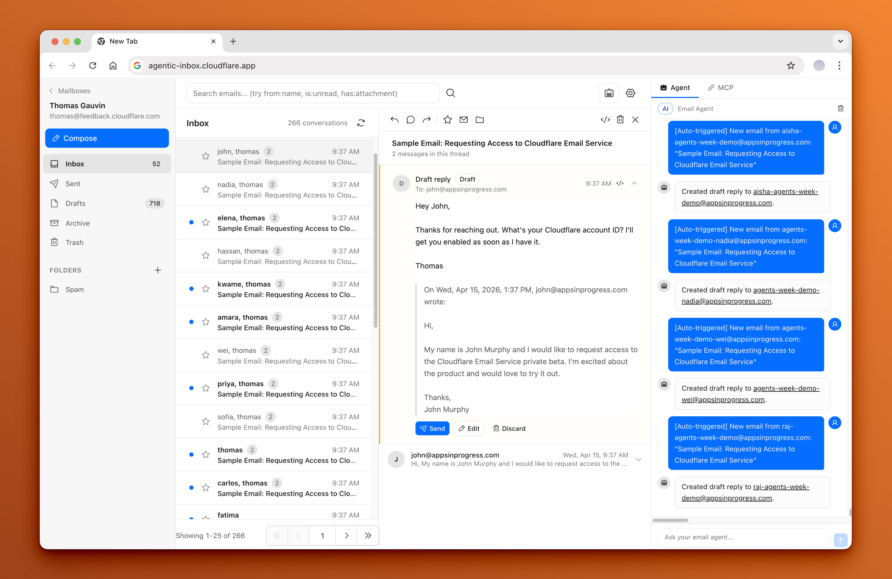

<div align="center">
  <h1>cloudmail</h1>
  <p><em>A self-hosted email client with an AI agent, running entirely on Cloudflare Workers</em></p>
</div>

cloudmail lets you send, receive, and manage emails through a modern web interface -- all powered by your own Cloudflare account. Incoming emails arrive via [Cloudflare Email Routing](https://developers.cloudflare.com/email-routing/), each mailbox is isolated in its own [Durable Object](https://developers.cloudflare.com/durable-objects/) with a SQLite database, and attachments are stored in [R2](https://developers.cloudflare.com/r2/).

An **AI-powered Email Agent** can read your inbox, search conversations, and draft replies -- built with the [Cloudflare Agents SDK](https://developers.cloudflare.com/agents/) and [Workers AI](https://developers.cloudflare.com/workers-ai/).



> **Naming**: "cloudmail" is only the default. The displayed app name, tagline,
> accent colour and logo are configurable at **Settings → App branding** and stored
> per deployment, so no code change is needed to rebrand.


Read the blog post to learn more about Cloudflare Email Service and how to use it with the Agents SDK, MCP, and from the Wrangler CLI: [Email for Agents](https://blog.cloudflare.com/email-for-agents/).

## Quick start

[](https://deploy.workers.cloudflare.com/?url=https://github.com/cloudmail-hq/cloudmail)


The button creates the Worker, R2 bucket, KV namespace, Vectorize index, Durable Objects and Workers AI binding.

1. **Deploy.** Keep the Worker name in the form (or set `WORKER_SCRIPT_NAME` to the new one). Fill `SETUP_TOKEN` and `AUTH_SECRET` with the output of `openssl rand -base64 32` each, and keep the setup token in a password manager: it is also the break-glass recovery key. Leave `DOMAINS` and `CF_API_TOKEN` empty if you will connect a token in step 3.
2. **Create the owner.** Open the Worker's URL. The first visit redirects to `/setup`. Enter the setup token and create the owner account. If you left `SETUP_TOKEN` empty, the generated one is in the Worker's logs (dashboard → Workers → your Worker → Logs).
3. **Connect Cloudflare.** Paste one Cloudflare API token on the onboarding screen or at **Settings → Cloudflare connection**. The **Create token** link there opens the dashboard with the right permissions already filled in.
4. **Activate your licence.** Paste the licence key from your purchase email on the next onboarding step, or at **Settings → Licence**. Until then the app shows only the activation screen. See [Licence](#licence).
5. **Review and apply.** Pick your domains. The app shows a plan: what it will do on its own (enable Email Routing, point the catch-all at this Worker, onboard sending, add a monitor-only DMARC record, create the Vectorize metadata index), what needs your confirmation (anything that changes or removes a record you already have, such as another provider's MX), and anything you must do by hand. Apply it, then create a mailbox and send it a test from another account.

Invite teammates at **Settings → Users & invites**. Each invite is a one-time link you hand over yourself. No Cloudflare Access application is needed: sign-in is built in, and the tracking endpoints under `/t/*` are public by design (every request is HMAC-verified).

### Without a token

Set `DOMAINS` to your domain, then in the dashboard:

1. Your domain → **Email Routing** → enable it, and create a catch-all rule that sends to this Worker.
2. Onboard the domain in [Email Service](https://developers.cloudflare.com/email-service/) so outbound mail can be sent.
3. Create the Vectorize metadata index (see [Semantic search](#semantic-search-and-ask-my-inbox)).

**Settings → Domains** lists the exact DNS records each domain needs and checks them live.

### Deploy with an AI agent

Paste this into an AI agent that has terminal access (Claude Code, Codex, Cursor and similar):

```text
Install cloudmail from https://github.com/cloudmail-hq/cloudmail on my Cloudflare account.

1. Read README.md and wrangler.jsonc first.
2. Ask me for my Cloudflare account ID and a deploy API token, using a secret input.
   Use them only as CLOUDFLARE_ACCOUNT_ID and CLOUDFLARE_API_TOKEN for Wrangler.
   Never print them, commit them, write them to a tracked file, or pass them as
   command arguments.
3. Keep the Worker name exactly "cloudmail". Create the R2 bucket
   "cloudmail" and the Vectorize index "cloudmail-semantic" if they do not
   exist (README "Semantic search" has the commands).
4. Run `npm ci`, then `npm run deploy`, then `npm run secrets -- --deploy` to upload
   SETUP_TOKEN and AUTH_SECRET. Tell me the setup token it prints, once.
5. Create the metadata index:
   npx wrangler vectorize create-metadata-index cloudmail-semantic --property-name=mailbox --type=string
6. Give me the app URL. I will open /setup, create the owner account and connect
   my Cloudflare token in the app.
```

The deploy token needs **Workers Scripts Edit**, **Workers R2 Storage Edit**, **Workers KV Storage Edit**, **Vectorize Edit** and **Account Settings Read** on the target account. It is separate from the token you paste into the app in step 3.

### Plan requirements

The [Workers Paid plan](https://developers.cloudflare.com/workers/platform/pricing/) is recommended. Email Service sending requires it, mailboxes live in Durable Objects, and password hashing (scrypt) needs more CPU per sign-in than the Free plan's 10 ms limit comfortably allows.

### Prerequisites

- A Cloudflare account with a domain on Cloudflare DNS
- [Workers AI](https://developers.cloudflare.com/workers-ai/) enabled (for the agent)

## Features

- **Full email client** — Send and receive via Cloudflare Email Routing, with a rich text composer (attachments, inline images, cc/bcc with contact autocomplete, draft autosave, signatures, templates), threaded conversations, folders and labels, snooze, schedule send with a 30s undo window, search operators, and bulk actions
- **Rules, mute and vacation replies** — Inbound filter rules (file, label, flag, deprioritise or silence mail before you see it), muted conversations whose later replies go straight to Archive, and an auto-responder that refuses mailing lists, bounces, other responders and repeat replies to the same person
- **Fast search** — Full-text index over subject, body, sender and recipient, so search cost no longer grows with the mailbox
- **Live updates** — The workspace watches a cheap change counter instead of refetching lists on a timer, and can raise a browser notification when mail arrives while the tab is in the background
- **A bin that behaves like one** — Delete moves to Trash with an Undo, restore puts a message back where it came from, and anything left in Trash is destroyed after 30 days
- **Safe message rendering** — Bodies are sanitised and sandboxed, `cid:` images resolve to their attachments, and remote images are withheld until you ask for them so tracking pixels don't fire on open
- **Built-in accounts** — Email + password or passkey sign-in, optional TOTP 2FA (or a passkey as the second factor), invites, admin-issued or emailed ("Forgot password?") reset links and personal API tokens, with no Cloudflare Access required
- **Per-mailbox isolation** — Each mailbox runs in its own Durable Object with SQLite storage and R2 for attachments
- **Built-in AI agent** — Side panel with 9 email tools for reading, searching, drafting, and sending
- **Auto-draft on new email** — Agent automatically reads inbound emails and generates draft replies, always requiring explicit confirmation before sending
- **Configurable and persistent** — Custom system prompts per mailbox, persistent chat history, streaming markdown responses, and tool call visibility

## The UI

There is one mail interface. The kumo-based `/mailbox/:id/*` screens that shipped
with the upstream project have been removed, so anything the workspace cannot do
is a gap in the product rather than a reason to reach for another surface.

| Route | What it is |
| --- | --- |
| `/` | Mailbox chooser. Redirects straight into the inbox when there is only one mailbox |
| `/mail/:mailboxId/:folder` | The workspace: folder rail (including Spam), message list, reading pane, compose tray |
| `/mail/:mailboxId/label/:labelId` | Everything carrying one label, across folders |
| `/mail/:mailboxId/search?q=` | Search results (`from:`, `to:`, `subject:`, `is:`, `has:`, `before:`, `after:`) |
| `/mail/:mailboxId/settings` | Per-mailbox identity, signatures, block rules, filter rules, vacation auto-reply, forwarding, auto-draft, agent prompt |
| `/people` | The same mail grouped by correspondent, across every mailbox |
| `/templates`, `/sequences`, `/settings` | Shared resources and app-level settings (including who may reach which mailbox) |

## Stack

- **Frontend:** React 19, React Router v7, Tailwind CSS v4, Zustand, TanStack Query, TipTap, Radix primitives, `lucide-react`
- **Backend:** Hono, Cloudflare Workers, Durable Objects (SQLite), R2, Email Routing
- **AI Agent:** Cloudflare Agents SDK (`AIChatAgent`), AI SDK v7, Workers AI (`@cf/moonshotai/kimi-k2.5`), `react-markdown` + `remark-gfm`
- **Auth:** Built-in email + password sign-in (scrypt, TOTP 2FA, API tokens) with per-mailbox authorization; Cloudflare Access as an optional legacy mode. See [Security model](#security-model) and [Authorization](#authorization)

## Local development

```bash
npm install
cp .dev.vars.example .dev.vars
npm run dev
```

Run `npm run secrets -- --dev` to fill `SETUP_TOKEN` and `AUTH_SECRET` in `.dev.vars` (it prints the setup token), then visit `/setup`. If `SETUP_TOKEN` is empty, a random one is generated and printed in the terminal. Password auth runs for real in dev; set `DEV_AUTH_BYPASS=1` in `.dev.vars` to skip sign-in and treat every local request as an admin.

For a manual deploy, set your domain in `wrangler.jsonc`, create the bucket with `wrangler r2 bucket create cloudmail` (the bucket name in `wrangler.jsonc`), run `npm run deploy`, then `npm run secrets -- --deploy` to generate and upload `SETUP_TOKEN` and `AUTH_SECRET` (it prints the setup token and never replaces secrets that are already set).

### Multi-Domain Support

cloudmail supports multiple domains (Cloudflare zones). You can configure this in two ways:

**Simple:** Comma-separated domains in `DOMAINS`:
```
DOMAINS=example.com,mycompany.org,startup.io
```

**Advanced:** JSON array in `ZONES` for richer metadata:
```json
ZONES=[
  {"domain":"example.com","name":"Example Corp"},
  {"domain":"mycompany.org","name":"My Company","zoneId":"abc123"},
  {"domain":"startup.io","name":"Startup Inc"}
]
```

When multiple domains are configured:
- A domain selector appears in the top navigation
- Mailboxes are filtered by the selected domain
- Each domain can have its own mailboxes and email routing
- The selector persists across sessions

Domains can also be managed at runtime from **Settings → Domains** (admins only), `cloudmail domain …`, or `/api/v1/domains`. They are stored in the auth Durable Object and served alongside `DOMAINS`/`ZONES`; env domains appear there too (marked `env`) and cannot be deleted until removed from config.

Each domain page shows:
- the exact DNS records it needs (MX, SPF, DKIM, the `cf-bounce` sending records, DMARC) with copy buttons;
- a live DNS audit over DNS-over-HTTPS, with pass/warn/fail per record ("Re-check DNS"). DMARC is a warning when missing and when one already exists (keep yours; never publish two). SPF without `include:_spf.mx.cloudflare.net` is a warning;
- a catch-all mailbox: mail to an unknown address on the domain goes there instead of being dropped;
- **Provision on Cloudflare** when `CF_API_TOKEN` is set: finds the zone, enables Email Routing, points the catch-all at this Worker (`WORKER_SCRIPT_NAME`, default `cloudmail`), and creates the Email Sending domain. Idempotent and reports each step. Any existing catch-all rule, including Cloudflare's default disabled one, is left alone unless you tick "overwrite catch-all": with it off Cloudflare bounces unknown addresses, with it on they reach this Worker and are dropped unless the domain has a catch-all mailbox. Domains from `DOMAINS`/`ZONES` are already live, so provisioning one asks for confirmation (`confirmEnvDomain` in the API). Without the token the page lists the dashboard steps instead.

**Aliases.** A mailbox can receive extra addresses, including ones on other domains (mailbox settings → Addresses). One `support@` inbox can take `support@producta.com` and `support@productb.com`; replies default to the alias the message was sent to, and the composer's From picker lists every alias.

Inbound mail is routed on the envelope recipient (the `To:` header is used only when the envelope recipient is missing or on a domain this deployment does not serve): exact mailbox, then alias, then the domain's catch-all mailbox, else dropped and logged as before. If the alias lookup fails the message is retried rather than guessed. `EMAIL_ADDRESSES`, when set, keeps the old exact-mailbox-only behaviour. A mailbox cannot be created at an address that is an alias; remove the alias first.

**Note:** Each domain must have Email Routing configured in Cloudflare to receive emails (provisioning does this for you).

### Products

A product is the identity a group of domains and aliases sends as. Every domain gets a product of its own automatically, named after the domain. In **Settings → Products** (admins), `cloudmail product …` or `/api/v1/products` you can group several domains into one product, claim extra aliases, and set:

- display name, accent colour and logo (raster only, served publicly at `/p/:id/logo` so emails and the unsubscribe page can show it);
- a default signature. The composer adds it when you write from that product's address and swaps it in place when you change From. It is never duplicated, and a signature you inserted by hand is left alone. An alias of another product also sends under that product's display name;
- a reply tone and a knowledge snippet (text, or an https URL fetched into R2 with "Fetch now") for the agent. Auto-drafts and follow-up nudges append them after the mailbox's own prompt and rules, framed as reference material that cannot override them;
- default templates, listed first in the composer for that product.

A From address resolves to its product by alias first, then domain, then parent domain (`mail.acme.com` uses `acme.com`'s product). The unsubscribe page (`/u/:token`) uses the sending product's name, accent and logo. Templates can use `{{product_name}}`, `{{product_accent}}` and `{{product_logo_url}}`. `/api/v1/analytics/overview` accepts `product=<id|slug>` and filters to that product's domains.

**All inboxes** (`/mail/all/inbox`, on the dashboard and in ⌘K) lists conversations across every mailbox you can read, newest first. Each row has a product badge, and chips filter by product. Read, star and archive go to the owning mailbox, and opening a row goes to that mailbox's reader. One request fans out to at most 20 mailboxes; the rest are named in `truncated` (filter by product to reach them). It is also available as `GET /api/v1/inbox` (cursor-paged), MCP `list_emails` with `mailboxId: "*"`, and `cloudmail mail list --all`. MCP `list_products` lists products.

## Configuration

Secrets are set with `wrangler secret put NAME` or in the dashboard (Worker → Settings → Variables and Secrets). Vars can live in `wrangler.jsonc`.

| Name | Type | Purpose |
| --- | --- | --- |
| `SETUP_TOKEN` | secret | Authorizes creating the owner at `/setup` and break-glass recovery at `/recover`. If unset, a random token is generated once and written to the Worker logs while setup is pending; `/recover` stays disabled. `/recover` also stays disabled unless the value is at least 16 characters (`openssl rand -base64 24` works). |
| `AUTH_SECRET` | secret | Key material for encrypting TOTP secrets at rest. If unset, one is generated and stored in the auth Durable Object. Set it before anyone enables 2FA: setting or changing it later makes existing TOTP secrets undecryptable (see [Troubleshooting](#troubleshooting)). |
| `AUTH_MODE` | var | `password` or `access`. Unset: `access` when both `POLICY_AUD` and `TEAM_DOMAIN` are set, otherwise `password`. |
| `APP_URL` | var | Optional. Public base URL used in invite and reset links, the hostname passkeys are bound to, and the origin of tracking and unsubscribe links in mail sent with no request (scheduled sends, sequences, agent sends). Unset: invite and reset links use the request origin, and the app records the https origin you sign in on (a custom domain wins over `*.workers.dev`; localhost only in dev). Until an origin is known, scheduled and sequence mail goes out without tracking and unsubscribe links. Changing it (or the domain) invalidates existing passkeys. |
| `AUTH_EMAIL_FROM` | var | Optional. From address of "Forgot password?" emails, e.g. `cloudmail <no-reply@example.com>`. Unset: `no-reply@` the first domain in `ZONES`/`DOMAINS`. With neither, reset by email is off and the sign-in page tells people to ask an administrator. The domain must be onboarded to Email Service (see [Password reset by email](#password-reset-by-email)). |
| `ADMIN_EMAILS` | var | Comma-separated addresses that are always administrators. |
| `TURNSTILE_SITE_KEY` / `TURNSTILE_SECRET_KEY` | var / secret | Optional. When both are set, setup, sign-in and invite acceptance require a [Turnstile](https://developers.cloudflare.com/turnstile/) challenge (fails closed), as does "Forgot password?". |
| `DOMAINS` / `ZONES` | var | Domains you receive mail for. See [Multi-Domain Support](#multi-domain-support). |
| `EMAIL_ADDRESSES` | var | Optional allowlist of addresses mailboxes may be created for. |
| `EMAIL_ANALYTICS_TOKEN` | secret | API token with Analytics Read; lets the cron reconciler pull delivery verdicts from Email Service. Inert when unset. |
| `EMAIL_ANALYTICS_ZONE_TAG` | var | Zone id the reconciler queries in addition to any zone ids from `ZONES` and managed domains. |
| `CF_ANALYTICS_TOKEN` | secret | Optional, read-only. Powers the **Analytics** console (`/api/v1/analytics/*`): Cloudflare sending, reputation, quota, sending domains, routing, DMARC and suppressions. Needs **Account Analytics: Read**, **Zone Analytics: Read**, **Email Sending: Read**, **Email Routing Rules: Read**, **Email Routing Addresses: Read** and **DMARC Reports: Read**. GraphQL falls back to `EMAIL_ANALYTICS_TOKEN`; with neither, the page shows local data only. Responses are cached for 5 minutes. `CF_ACCOUNT_ID` is used when set, otherwise the account is read from the zone. |
| `CF_API_TOKEN` | secret | Optional. Lets **Settings → Domains → Provision** configure Cloudflare for you. Create a custom token with **Zone → Zone: Read**, **Zone → Zone Settings: Edit** (Write), **Zone → Email Routing Rules: Edit** (Write), **Account → Email Sending: Edit**, and **Zone → DNS: Read**, scoped to the zones you want managed. Unset: manual mode, the UI shows the records and dashboard steps. |
| `CF_ACCOUNT_ID` | secret / var | Optional. Scopes zone lookups to one account when the token can see several. |
| `WORKER_SCRIPT_NAME` | var | Optional. Script name the catch-all rule targets. Default `cloudmail`; set it on a deployment under another name. |
| `SEMANTIC_INDEX_NAME` | var | Optional. Name of the Vectorize index the `SEMANTIC_INDEX` binding names, used by onboarding to check and create its metadata index. Default `cloudmail-semantic`; set it if your index has another name. |
| `MIGRATION_TOKEN` | secret | Gates the one-off `/api/v1/_migrate/*` consolidation routes. Unset on a normal deployment (routes 404). |
| `POLICY_AUD` / `TEAM_DOMAIN` | secret | Legacy Cloudflare Access mode only. See [Legacy: Cloudflare Access mode](#legacy-cloudflare-access-mode). |
| `DEV_AUTH_BYPASS` | var | Local dev only. `1` skips sign-in and makes every request an admin. Ignored in production. |
| `VAPID_PUBLIC_KEY` / `VAPID_PRIVATE_KEY` | secret | Optional. Web Push key pair (base64url: the 65-byte public point and the 32-byte private scalar). Unset: a pair is generated once and kept in the auth Durable Object. Changing it drops every device's subscription; each browser resubscribes when the app is next opened. |
| `VAPID_SUBJECT` | var | Optional. Contact push services can reach (`mailto:` or `https:`). Default: `APP_URL`. |
| `LICENCE_ENFORCEMENT` | var | `enforce` requires an active licence (the deploy template sets it). Any other value, or unset, turns the licence gate off. See [Licence](#licence). |
| `LICENCE_SERVER_URL` | var | Optional. Base URL of the licence server. Default: the vendor's licence server. |

## Licence

cloudmail is licensed per deployment. The licence is a one-time purchase.

- **Activation.** An administrator pastes the licence key in the onboarding wizard (after **Connect Cloudflare**) or at **Settings → Licence**. The app sends the key once to the licence server, together with this deployment's id, its host name and the connected Cloudflare account id. It gets back a signed token bound to this deployment and host. Only the token is stored, in the auth Durable Object. The key is never stored or logged.
- **Checks.** The app verifies the token offline against public keys bundled in `shared/licence-keys.ts`, and never fetches keys at runtime. The 5-minute cron refreshes it once a day, as does the first request after `refresh_after`. A token is valid for 30 days and is extended at each refresh. That is a check-in, not a renewal: there is nothing to pay again.
- **When a check fails.** The app keeps working. Once the token is past its expiry, admins see a banner: "Licence couldn't be renewed, N days left". After 7 more days, or at once if the licence is revoked (a refund, a lost dispute, or deactivation), the app locks.
- **When locked:**
  - The UI shows one "Activate your licence" screen: a key field for admins, "Ask your admin" for everyone else. API, MCP and token calls answer 402 `licence_required`.
  - Incoming mail is **always received and stored**, so nothing bounces. Forwarding, auto-replies, AI triage, push notifications and webhooks pause.
  - Sending stops. Scheduled sends that come due are held and go out after activation, and sequence steps stay pending.
  - Recipient-facing links keep working: unsubscribe, tracking, the privacy page and product logos.
  - Password reset still works, so an admin can always sign in to activate.
- **Moving or freeing a slot.** **Settings → Licence → Deactivate** (with the key) frees this deployment's slot at the licence server, and the deployment locks.


## Security model

- **Passwords** are hashed with scrypt (N=2^15, r=8, p=1) via native `node:crypto`, NFKC-normalized, compared in constant time. Unknown accounts take the same time to reject as wrong passwords.
- **Sessions** are opaque random tokens in a `__Host-` cookie (`HttpOnly`, `Secure`, `SameSite=Lax`), with a 14-day idle and 30-day absolute lifetime. Every sign-in issues a fresh session; changing a password revokes your other sessions, a reset revokes all of them.
- **Storage**: sessions, API tokens, invites and reset links are stored only as SHA-256 hashes, in a single SQLite Durable Object. TOTP secrets are encrypted with AES-GCM under a key derived from `AUTH_SECRET`.
- **Brute force**: per-IP rate limits on every auth endpoint (per email + IP for sign-in). Behind them, lockouts in the auth Durable Object that hold even without the rate limiter binding: wrong passwords lock an email + IP pair after 5 failures (30 s, doubling to 15 min), so an attacker elsewhere cannot lock you out; unknown emails lock the same way and take the same time, so lockout reveals nothing about which accounts exist. More than 100 failures for one account within an hour is logged as a warning, not locked. Optional Turnstile on top.
- **2FA**: TOTP (any authenticator app) with one-time recovery codes. Wrong codes count per account across sign-in attempts and lock the second factor with the same backoff; a successful second factor resets it. TOTP secrets are encrypted under `AUTH_SECRET`, so set it before anyone enables 2FA and never change it afterwards.
- **Passkeys** (WebAuthn, via `@simplewebauthn`): sign in with no email or password, or use one as the second factor after a password. Every passkey ceremony requires user verification (fingerprint, face or device PIN), so a passkey sign-in is a complete sign-in and skips the TOTP step. Challenges are server-side, single use, valid 5 minutes and bound to their purpose and user. Signature counters that go backwards are refused and logged as a possible cloned authenticator. Adding a passkey needs a browser session that signed in (or re-confirmed with a password, code or existing passkey) within the last 15 minutes. Passkeys are bound to the deployment's hostname (`APP_URL` if set, else the address you use): **moving to another domain makes existing passkeys stop working**, and users sign in with their password and add new ones. Disabling or deleting a user removes their passkeys; `/recover` keeps the owner's.
- **API tokens** act as their user for mail, the CLI and MCP, narrowed by optional scopes and a mailbox allowlist (see [Programmatic access](#programmatic-access)). They cannot change credentials or accounts: changing the password or 2FA, revoking sessions and every change under user administration need a browser session. Admins can still list users and invites with an unscoped or `admin`-scoped token. A scoped token may mint only a narrower child token, which dies with it.
- **CSRF**: state-changing requests are checked against `Sec-Fetch-Site` / `Origin`.
- **Account lifecycle**: invites and admin reset links are one-time links an admin generates and shares, so neither needs outbound auth email. Disabled or deleted users lose their sessions and tokens immediately.
- **Reset by email**: `/forgot` emails a one-time link valid for 30 minutes. The response is the same 202 whether or not the account exists, and the lookup and send run after it, so neither the body nor the timing reveals which addresses have accounts. Rate limited per IP and per address, and capped at 3 emails per account per hour so the form cannot be used to flood someone's inbox. Disabled accounts get nothing. Using the link revokes every session but leaves 2FA on (unlike `/recover`), so an inbox alone does not get past an authenticator. The email omits the requester's IP and time.
- **Account lifecycle (admins)**: only the owner can generate a reset link for the owner, and nobody can generate one for themselves (use the password change instead).
- **Break-glass**: `/recover` resets the owner's password, disables owner 2FA and revokes the owner's sessions, given `SETUP_TOKEN`. It only works when `SETUP_TOKEN` is set as a secret of at least 16 characters. Wrong tokens are logged, and after 10 within an hour `/recover` closes for an hour for everyone.

## Inbound mail trust

- **Authentication results** come only from our own MX. The reading pane, the spam score, and every automatic action use the topmost `Authentication-Results` header, and only when its authserv-id is `mx.cloudflare.net` (Cloudflare Email Routing). Any other `Authentication-Results`, and any `ARC-Authentication-Results`, was written by the sender or an earlier hop and could be forged. ARC is never used to show a sender as verified, only to report a failure. With no trusted result, the trust level is `unknown`.
- **Actions on the sender's say-so** need an authenticated sender. A mailto unsubscribe (`subject: unsubscribe`) and the vacation auto-reply act only when our MX reports DMARC pass, or an SPF or DKIM pass aligned with the From domain. Forwarding skips mail whose authentication failed (DMARC fail, or SPF and DKIM both failing). Email Routing already rejects SPF+DKIM double failures and DMARC-reject mail before the Worker runs; the `email()` handler receives no verdict of its own, so the header is the only verdict available.
- **Reader warnings** are computed at delivery and stored with the message: look-alike sender domains (IDN homographs, mixed scripts, one or two edits from your own domains or regular correspondents), a display name that shows another address or domain or reuses a known person's name from a different address, links whose text shows one domain and open another, and first contact. The reader shows a banner, the list shows an icon, and MCP `get_email` returns `warnings[]` and `sender_trust`.
- **Remote images** stay blocked until you allow them. Allowed images load through `/img/:sig`, a proxy in the Worker, so senders see Cloudflare's address instead of yours. Each URL is HMAC-signed by the Worker inside an authenticated read and expires within two days. The proxy fetches https only, refuses private, loopback, link-local and metadata addresses (including IPv4-mapped, NAT64 and 6to4 forms) and this deployment's own hosts, re-checks every redirect (at most 3), and accepts only raster images up to 5 MB within 10 s. It sends no cookies or referrer, and caches results with the Cache API. Known tracking pixels (1×1 or hidden images, and open-tracking hosts such as Mailchimp, HubSpot and SendGrid) stay blocked even after you allow images, and the reader says how many were blocked. The page CSP allows images only from `'self' data: blob:`.
- **Link cleaning**: `utm_*`, `fbclid`, `gclid`, `mc_eid` and similar parameters are removed from links in received mail when it is displayed. Turn this off under Settings → Display preferences. Our own outbound click tracking is unaffected.

Optional secret: `IMAGE_PROXY_SECRET` signs image proxy URLs. When it's unset, a key is generated once and kept in the AuthDO. Rotating it only makes open messages re-sign their images on the next read.

**HSTS**: the Worker and `public/_headers` (for static assets, which the Worker never sees) both send `Strict-Transport-Security: max-age=31536000; includeSubDomains`. If the zone's own HSTS setting (SSL/TLS → Edge Certificates) is on, Cloudflare replaces that header on every response. Turn on **Include subdomains** there, or turn zone HSTS off.

## Authorization

The built-in sign-in decides *who* gets in. Grants decide *what they can reach*. In password mode enforcement is always on:

- **Administrators** are the owner, every address in `ADMIN_EMAILS`, and anyone holding a grant with `role: "admin"`. They reach every mailbox. `ADMIN_EMAILS` lives in configuration rather than beside the grants it protects, so a bad grant cannot lock those addresses out.
- Everyone else is a **member** and reaches only the mailboxes granted to them. No grant means no access. Accepting an invite writes the grant chosen when the invite was created.
- Manage grants at **Settings → Access**, or via `GET /api/v1/access`, `PUT /api/v1/access`, `DELETE /api/v1/access/{kind}/{id}`. Grants are keyed by email address.

Every way into a mailbox is covered by the same rule:

| Surface | Where it is enforced |
| --- | --- |
| REST API | `requireMailbox` decides *whether*, `requireCapability` decides *how far* — mounted as path middleware, so a route added under an already-gated path inherits its gate |
| Mailbox list, person views | Narrowed to what the caller may see, so a member never sees an address they cannot open |
| MCP (`/mcp`) | The principal is handed to the agent as props by the Worker, never by the client; `list_mailboxes` is filtered, and `verifyMailbox` takes the capability each tool needs as a required argument so a new tool cannot inherit read-only authority by omission |
| Agent (`/agents/*`) | The instance is addressed by mailbox name, so the name is authorized before routing. The socket also requires `draft`, because every tool the agent has writes a draft or files mail and HTTP middleware cannot see individual messages once the socket is open |
| Sequence enrollment | `fromAddress` is checked, because the cron dispatcher sends it later with no caller attached |

### Per-mailbox roles

Reaching a mailbox is not the same as having authority over all of it. Granting
someone a shared `support@` inbox should let them answer mail, not rewrite its
forwarding address to one they control. So a grant carries a role:

| Role | May |
| --- | --- |
| `viewer` | Read only |
| `agent` | Read, draft, reply *on behalf of* the mailbox, file mail, move to Trash |
| `manager` | The above plus send *as* the mailbox, empty the Trash, manage rules and blocking |
| `owner` | Everything, including identity, signatures, forwarding, the agent prompt, and handing the mailbox to somebody else |

The vocabulary is borrowed from [Exchange mailbox permissions](https://learn.microsoft.com/en-us/exchange/recipients/mailbox-permissions)
(`FullAccess` / `Send As` / `Send on Behalf`) and [Gmail delegation](https://support.google.com/mail/answer/138350),
so a grant means what an operator expects. The two send capabilities differ in
attribution rather than in power: `sendOnBehalf` emits an RFC 5322 `Sender:`
header naming the person who actually sent it, which Outlook renders as
"<sender> on behalf of <mailbox>"; `sendAs` deliberately emits nothing, so the
message is indistinguishable from one the mailbox owner sent. Where a principal
holds both, Send As wins — the same precedence Exchange applies.

A grant can also add or remove individual capabilities on top of a role, for the
cases a preset cannot express — giving one agent `sendAs`, or taking
`deletePermanently` off a manager. Revocations are applied last, so a record that
contradicts itself resolves the restrictive way.

**A bare mailbox address in a grant means full access.** Grants written before
roles existed list plain addresses, and reading them as anything narrower would
silently revoke authority people are relying on. Narrowing is opt-in per mailbox,
and a full-access entry is still stored as a plain string so enabling this does
not rewrite every existing record. `GET /api/v1/me` reports the expanded
capability list per mailbox, and `GET /api/v1/access` serves the role vocabulary
the Worker actually enforces so the UI cannot offer a role that would be rejected
on save.

Administrator-only: creating and deleting mailboxes, branding, and instance-wide
grant management. Deleting a mailbox also strips it from every grant that named
it, so re-creating the address later does not silently restore access.

### Delegating your own mailbox

`PUT /api/v1/access` is admin-only for a structural reason: a grant record is keyed
by *grantee* and lists every mailbox they can reach, so writing one wholesale is
authority over the whole deployment. On its own that made the most ordinary
delegation there is impossible — the person whose mailbox it is could not give their
own assistant access without an administrator doing it for them, which is not how
either product this vocabulary comes from behaves.

So `owner` carries a `manageDelegates` capability, and a second set of routes is
scoped to one mailbox:

| Route | Who |
| --- | --- |
| `GET /api/v1/mailboxes/{id}/delegates` | Whoever holds `manageDelegates` there |
| `PUT /api/v1/mailboxes/{id}/delegates` | Same — grant one principal, or change their role |
| `DELETE /api/v1/mailboxes/{id}/delegates/{kind}/{principal}` | Same — revoke |

Available in the UI at **that mailbox's settings → Who else can use this mailbox**.

These are scoped by construction rather than by checking. They read and write
exactly one entry of one grant — the mailbox in the path — so:

- an owner cannot touch another mailbox's entry even by asking, and a delegate who
  holds mailboxes from other owners keeps those untouched;
- the grant's own role is pinned to `member`, so this can never be a promotion
  route;
- reading the list returns only this mailbox's entry for each delegate, because the
  other mailboxes in someone's grant are not the owner's to see;
- `manageDelegates` belongs to `owner` alone, so an agent or manager on a shared
  inbox cannot re-delegate it — Gmail's rule that a delegate cannot re-delegate;
- an existing administrator is refused rather than given an entry, since their
  reach comes from their role and an entry would change nothing while reading in
  the UI like a demotion.

Administrators reach every mailbox without an entry, so the list names them
explicitly: a short list would otherwise imply nobody else can get in.

### Access log

Delegated access without a record of its use is half a feature. Once someone other
than the owner can send from a mailbox, the message carries the *mailbox's*
address, so "who sent that as us" is not answerable from the mail — and a deleted
message leaves nothing at all.

Every entry is classified by the actor's relationship to the mailbox — `owner`,
`delegate`, `admin` or `system` — mirroring how
[Exchange audits mailbox access](https://learn.microsoft.com/en-us/purview/audit-mailboxes)
by sign-in type. That is the distinction that makes the log answerable: the same
person is an owner on their own mail and a delegate on the shared inbox, and only
the second needs explaining.

Recorded: sends (with the attribution used), deletions, destructions, settings
writes, mailbox creation and deletion, and every grant change. Reads are not — a
mail client reads constantly, so recording every message opened would bury the
entries an operator is looking for and cost a write per message view. Neither
subjects, bodies, nor the forwarding address are stored: a log that quoted mail
would be a second copy of the mailbox, readable by whoever can read the log.

| Scope | Where | Who can read it |
| --- | --- | --- |
| Deployment | **Settings → Access log**, `GET /api/v1/access/audit` | Administrators |
| One mailbox | `GET /api/v1/mailboxes/{id}/audit` | Whoever holds `manageSettings` on it — an agent works in a shared inbox without seeing who else has |

Entries are one R2 object each under `audit/{mailbox|_instance}/`, keyed by an
*inverted* timestamp so R2's own key order is newest-first. Reading a page is
therefore one list of exactly the rows returned rather than a scan, which is what
keeps the log usable as it grows. Append-only by construction, so two concurrent
writers cannot lose each other's entry, and neither a failed write nor an
unavailable `ExecutionContext` can fail the action being recorded — a logging
outage must not become a mail outage. Deleting a mailbox destroys its log but
keeps the deletion itself in the deployment scope, so a re-created address does
not inherit history from its predecessor.

## Password reset by email

"Forgot password?" on the sign-in page sends a reset link from `AUTH_EMAIL_FROM` (or `no-reply@<first domain>`) through the same `EMAIL` binding the mailboxes use. It is sent directly, not from a mailbox: it is not stored in any Sent folder, does not count against a mailbox's outbound quota, and is not tracked.

What Cloudflare requires ([Email Service docs](https://developers.cloudflare.com/email-service/platform/limits/), [pricing](https://developers.cloudflare.com/email-service/platform/pricing/)):

- The sender address must be on a domain onboarded to Email Service sending (Compute → Email Service → Email Sending, which adds the SPF/DKIM/DMARC records). A `no-reply@` address on that domain needs no mailbox.
- Until a sending domain is onboarded, Email Service only delivers to **verified destination addresses** in your Cloudflare account. Sending to arbitrary recipients needs an onboarded domain and the Workers Paid plan (sends to verified destinations are free and do not count against quotas).
- New accounts start with a conservative daily sending quota that grows with reputation. A failed send is logged (`[auth] Failed to send a password reset email`) and is not reported to the requester, by design.

There is no separate on/off switch: any deployment with `DOMAINS` (or `AUTH_EMAIL_FROM`) and the `EMAIL` binding offers the form. If its domain is not onboarded for sending, requests still get the generic 202 but nothing arrives; the failure appears only in the Worker logs. Admin-issued reset links keep working either way.

## Suppressions and unsubscribe

The deployment keeps one suppression list (in the AuthDO). Each entry is an address, a scope (`global`, or a single sending domain so unsubscribing from one product doesn't silence the others), a reason (`unsubscribed`, `hard_bounce`, `complaint`, `manual`), a source and a timestamp.

Every outbound message passes one pre-send gate (`workers/lib/pre-send.ts`): Cloudflare's per-message limits, the mailbox's send caps, the spam-rate circuit breaker, and the suppression list. `sendEmail` will not run without the gate's clearance, and a test enumerates every send path. How suppressions apply depends on the kind of mail:

| Kind | Paths | Blocked by |
| --- | --- | --- |
| Bulk | Sequence steps, template sends (REST `POST /mailboxes/:id/template-sends` and MCP `send_template`), `POST /emails` with `transactional: false` or `list: true` | Every suppression. A suppressed recipient is dropped (a sequence enrollment is cancelled); no To left is a 422. |
| Transactional | The composer (including scheduled and undo-send), replies and forwards, `POST /emails` (default), agent and MCP `send_email`/`send_reply`/`forward_email` | `hard_bounce`, `complaint` and `manual` entries. An `unsubscribed` address still gets one-to-one mail, and the response lists it in `suppression_warnings`; the composer shows a chip. |
| Automated | Vacation auto-reply, automatic forwarding | Every suppression. |
| System | Password reset | Never filtered. |

Someone who unsubscribed from a drip campaign and then writes to support still gets an answer. Someone who reported you as spam does not.

How it fills up:

- Sequence mail, template sends and single-recipient bulk API sends carry RFC 8058 headers: `List-Unsubscribe: <https://<host>/u/<token>>, <mailto:<mailbox>?subject=unsubscribe>` and `List-Unsubscribe-Post: List-Unsubscribe=One-Click`. They also get a small footer unless the template places `{{unsubscribe_url}}` itself, or `UNSUBSCRIBE_FOOTER=off` is set.
- `/u/:token` is public. GET shows a confirmation page and records nothing, so link scanners can't unsubscribe anyone. POST (the button, or a provider's one-click request) suppresses the address for that sending domain and stops its sequences. The token is HMAC-signed, and the path is exempt from the CSRF guard because it reads no cookie.
- A reply to the mailto link with the subject `unsubscribe` does the same.
- Permanent, address-level bounces (DSN 5.1.x and 5.2.1 for a message the mailbox really sent, and reconciler verdicts such as `user_unknown`) add a global `hard_bounce` and stop sequences. Policy rejections (5.7.x) and full mailboxes don't.
- When Email Service refuses a send with `E_RECIPIENT_SUPPRESSED`, the address is mirrored locally as a `hard_bounce`.
- Spam complaints become a permanent `complaint` entry for the sending domain and stop that domain's sequences. They arrive three ways: feedback-loop reports (ARF, `multipart/report; report-type=feedback-report`) sent to a mailbox, which only count when they name a message that mailbox really sent to that recipient; `complained` verdicts from the delivery reconciler; and, hourly, Cloudflare's own `complaint` suppressions (`CF_ANALYTICS_TOKEN`). A complaint for an address that had only unsubscribed upgrades the entry.

Bulk mail also carries `List-Id: <slug.domain>` (the template slug, or the sequence name), which Gmail uses to group feedback per stream.

**Unsubscribe processing time.** Gmail and Yahoo require unsubscribes to be honoured within 48 hours. Ours take effect at once: the one-click `POST /u/:token` (no session, exempt from CSRF, mounted before authentication) writes the suppression before it answers 200, and the next send to the address is refused. If the write fails it answers 503 so the provider retries, rather than claiming success.

### Spam-rate circuit breaker

Hourly (on the cron), the app computes each sending domain's spam complaint rate over the last 7 days: complaints ÷ delivered, from the local delivery ledger and, when `CF_ANALYTICS_TOKEN` is set, Cloudflare's `emailComplaintsAdaptiveGroups` and `emailSendingAdaptiveGroups` plus the account reputation status. The worse of the two wins. Below 100 delivered messages the rate is not acted on.

- **Above 0.1%:** a warning banner across the app and a `deliverability.warning` webhook.
- **Above 0.3%** (the Gmail and Yahoo limit), or Cloudflare reporting the account `at_risk`: bulk sends from that domain (sequences, template sends, `transactional:false`) pause. Sequence steps wait; template and bulk API sends answer 423 `bulk_paused`. Transactional and one-to-one mail continue.
- **Resume:** an administrator resumes from Analytics → Spam complaints or Settings → Domains, or `POST /api/v1/sending-health/:domain/resume`. It is audited (`sending.resume`). The breaker does not re-pause for 24 hours, since the 7-day window still holds the complaints that tripped it.

`GET /api/v1/sending-health` lists every domain's rate, level and pause state; `POST /api/v1/sending-health/evaluate` runs it now; `POST /api/v1/sending-health/:domain/pause` pauses by hand.

Sequences also stop on reply: an inbound message from someone enrolled in a sequence sent from that mailbox cancels the enrollment. Auto-replies don't count.

Manage the list at Settings → Suppressions (admins), through `/api/v1/suppressions` (`GET ?q=&scope=&reason=&limit=&offset=`; `POST {address, scope?, reason?}` or `{entries: [...]}`; `POST /import` with a CSV body or `{csv}`; `DELETE /:id`; `POST /check {addresses, from?}`), or with `cloudmail suppression list|add|remove|import`. Reading and checking the list is open to any signed-in user. Changing it needs an admin.

Optional secret: `UNSUBSCRIBE_SECRET` signs the unsubscribe tokens. When it's unset, a key is generated once and kept in the AuthDO. Rotating it breaks every unsubscribe link already sent.

## Open and click tracking

Every message you send gets a 1×1 open pixel and wrapped links, unless the mailbox turns them off (Settings → Tracking). This covers the composer (including undo-send and scheduled sends), replies and forwards, `POST /emails`, template sends, sequences, and the agent/MCP send tools.

- **Not tracked:** vacation auto-replies, automatic forwarding of received mail, password-reset and system mail, and plain-text messages.
- **Your copy stays clean.** Only the recipient's copy carries the pixel and rewritten links. Sent shows the message as you wrote it, and the reading pane never loads one of the app's own pixels, even one quoted back in a reply.
- **Self-opens are ignored.** If a pixel or link request carries a session cookie for someone who can read the mailbox, it isn't counted.
- **Opened is not read.** A pixel load means the image was fetched. Apple Mail Privacy Protection fetches it ahead of time, and the Gmail, Yahoo and Outlook proxies fetch it when the message renders. Each open records the user agent and, when one is recognised, which proxy fetched it. The UI then says "likely via a mail-privacy proxy".
- **One pixel per message.** A message to several To/Cc/Bcc recipients is one MIME body, so its opens and clicks are counted for the message and not for any one recipient. Template sends and sequences send one message per recipient, so those are counted per person.

The Sent list shows a status per message: a clock while sending, ✓ sent, ✓✓ delivered, ✓✓ plus an eye once opened, and a link icon once clicked. The REST list and get responses carry `opened_at`, `last_opened_at`, `open_count`, `open_proxy_count`, `clicked_at` and `click_count`. MCP `list_emails` and `get_email` add an `engagement` object for sent mail, and `cloudmail mail list --folder sent` adds a status column. Tracking URLs use the request's origin. Cron and scheduled sends use the origin captured at queue time, then `APP_URL`, then the origin recorded from signed-in requests; with none of those they go out untracked and without an unsubscribe link, and the Worker logs one warning.

## Privacy and data controls

The defaults are unchanged for existing deployments: tracking stays on, no disclosure line is added, and nothing is deleted except what Trash already cleared after 30 days. The operator is responsible for having a lawful basis for tracking recipients and for the wording of the privacy notice. Have both reviewed by counsel; nothing here is legal advice.

**Tracking controls.**
- **Per mailbox:** mailbox Settings → Tracking & privacy has switches for open, click and attachment tracking. The API is `GET`/`PATCH /api/v1/mailboxes/:id/settings/tracking`, and changing it needs `manageSettings`.
- **Per message:** the composer's "Don't track this message" switch sends that message without a pixel or wrapped links. The API equivalent is `"track": false` on `POST /emails`, scheduled sends and template sends; for the CLI it's `cloudmail mail send --no-track`, and the MCP send, reply, forward and schedule tools take `track: false`. `track: true` can't turn tracking on for a mailbox that has it off.
- **Recipient opt-out:** the unsubscribe page (`/u/:token`) has an "Also stop tracking my opens and clicks" box. Ticking it records the address for the sending domain, and later mail from that domain to that address goes out untracked. When a message has several recipients and any of them opted out, the whole message is untracked. If the lookup fails, the message is sent untracked. The RFC 8058 one-click unsubscribe never sets the opt-out, because mail clients send it without asking the person.
- **Disclosure line:** an optional line, "This message may track opens and clicks." or your own text (300 characters at most), added to the end of tracked mail. It's off by default and set per mailbox in the same settings section.
- **New mailboxes:** setup asks whether new mailboxes start with tracking on (the default) or off. Admins can change this later under Settings → Privacy & retention. Existing mailboxes keep their own setting.

**Privacy notice.** `/privacy` is a public page built from Settings → Privacy & retention. It covers the controller and contact, the Grievance Officer, what's processed (including tracking and AI on Workers AI), the retention periods actually enforced, and users' rights. Sign-in, the unsubscribe page and the account menu link to it. Fill in the controller and Grievance Officer before you go live; the page says "not yet published" until you do. The API is `GET /api/v1/privacy`, with `PUT` for admins.

**Retention.** A daily pass, driven by the 5-minute cron, deletes:

| Data | Default | Bounds |
| --- | --- | --- |
| Open, click and download events | 13 months (395 days) | 1 to 3650 days |
| Delivery events (sent, delivered, bounced) | 13 months | 1 to 3650 days |
| AI assistant chat | 90 days | 1 to 3650 days |
| Audit log (R2 `audit/`) | 1 year | 365 to 3650 days (DPDP Rule 6 floor) |
| Trash | 30 days | 1 to 365 days |

The pass is bounded so it never runs long. Each cron run handles 25 mailboxes and 1000 audit entries, and each mailbox deletes 500 events per batch, continuing by alarm until it's done. Counts are logged as `retention:`. A row exactly at the cutoff is kept.

**Export and delete (Settings → Account & security → Your data).**
- **Export my data** builds a zip in R2 in the background. It contains `account.json` (profile, sessions, API token and passkey metadata, but never secrets or hashes; connected apps, mailbox access and settings) plus one `.mbox` file per mailbox the user owns, or every mailbox for an admin. The download link is signed, works only for the signed-in user, and expires after 24 hours, when the file is deleted. Starting an export needs a recent sign-in.
- **Delete my account** needs a password or passkey confirmation within the last 15 minutes. It immediately signs the user out everywhere and revokes their API tokens, connected apps and reset links. The account and its data are purged after a 7-day grace period, and signing in during that time and choosing "Keep my account" cancels it.
  - What's purged: mailboxes the user owns that no other user or service token has access to. Shared mailboxes are kept.
  - The owner can't delete their own account, because the deployment always has exactly one owner. To retire the deployment, delete it in Cloudflare instead.
  - The API is `GET`/`POST /api/v1/account/exports`, `DELETE /api/v1/account` and `POST /api/v1/account/deletion/cancel`. These routes need a browser session; API tokens can't use them.

No new secrets are needed. Export links are signed with a key derived from `UNSUBSCRIBE_SECRET` (or its generated fallback), so rotating that secret also invalidates outstanding export links.

If you suspect a breach, follow [docs/security/breach-runbook.md](docs/security/breach-runbook.md).

## Follow-up reminders

"Remind me if no reply" on sent mail. Pick 1 day, 3 days, 1 week, Auto, a custom time or Off from the bell beside Send. If nobody else writes into the thread by then, the message returns to the Inbox unread with a **Follow up** label, and **Sent → Awaiting reply** lists every reminder by due date.

- **Cancelled by a reply.** Any inbound message in the thread ends the reminder. Out-of-office replies, bounces, list mail and Spam don't count. Replying again yourself restarts the same clock. Dismissing a fired reminder puts the message back where it was.
- **Auto** runs a small Workers AI yes/no classifier (`@cf/meta/llama-3.1-8b-instruct-fp8`) on your text with quoted history stripped. It sets a 3-day reminder only when the message asks a question or requests an action. If the model fails, no reminder is set.
- **Per mailbox** (Settings → Follow-up reminders): the default for new messages (off, 3 days or auto), and an optional nudge draft written by the agent when a reminder fires. The draft goes to Drafts and is never sent automatically.
- **API:** send bodies take `followup: {mode: "off"|"manual"|"auto", delay_seconds?|at?}`. Omit it to use the mailbox default. The routes are `GET /mailboxes/:id/followups`, `POST /emails/:id/followup` and `POST /emails/:id/followup/cancel`. MCP adds `list_awaiting_reply` and `set_followup`. The CLI is `cloudmail followup list|set|cancel`.

Reminders share the mailbox's one Durable Object alarm with snoozes and scheduled sends.

## Importing mail

Settings → Import brings old mail into a mailbox, from a file or from an IMAP account.

- **Files:** an `.mbox` (Google Takeout's Mail export is one), a `.zip` of `.eml` files, or a single `.eml`, up to 50 GB. The browser or CLI uploads it to R2 in parts (R2 multipart, through the Worker, so no S3 credentials are needed), and the mailbox's Durable Object alarm imports it in bounded batches.
- **IMAP:** host, username and an app password. The import connects with TLS on port 993 only, and opens folders read-only (`EXAMINE`, `BODY.PEEK[]`), so nothing on the old account changes. Private, loopback, link-local and metadata hosts are refused by the same guard webhook URLs use. The password is encrypted with a key derived from `AUTH_SECRET` (AES-GCM, bound to the job) and stored in the AuthDO. It is deleted when the import completes, fails or is cancelled.
- **What is kept:** the original Date and Message-ID, threading by Message-ID (no subject guessing for old mail), read and starred state, attachments, and Gmail labels from `X-Gmail-Labels`: Inbox, Sent, Spam and Trash become folders, user labels and categories become labels, and drafts get a Drafts label in Archive. IMAP folders map the same way, and `[Gmail]/All Mail` is read last, so a message seen in a labelled folder first keeps that label.
- **Deduplicated** by Message-ID, or by content hash when there is none, across every folder including Sent. Re-running an import adds nothing.
- **No side effects.** Imported rows are flagged `imported`. They skip the inbound pipeline: no forwarding, auto-replies, webhooks, realtime events, desktop notifications, triage, follow-ups, sequence stops or bounce handling. They also don't count against the send cap or in analytics. The one-off summary backfill may still summarise the newest conversations within the usual daily cap.
- **Resumable.** The cursor (byte offset, zip entry, or per-folder UID) is saved after every message. An interrupted run picks up where it stopped. Pause, resume and cancel are in the UI, the API and the CLI. Messages over 25 MB are counted as skipped.
- **API:** `POST /mailboxes/:id/imports` (honours `Idempotency-Key`), `PUT /imports/:id/parts/:n`, `POST /imports/:id/complete|pause|resume|cancel`, and `GET /imports` and `GET /imports/:id` for progress. Writes need `manageSettings`. There is no MCP tool: agents do not start imports.
- **CLI:** `cloudmail import mbox <file> --mailbox you@example.com` streams the file in 5 MiB parts. `cloudmail import imap --host … --user …` reads the password from a hidden prompt or `--password-stdin`. `cloudmail import status [id] [--wait]` shows progress.

There is no Gmail API import yet. The next step is an OAuth import behind an operator's own `GOOGLE_CLIENT_ID`/`GOOGLE_CLIENT_SECRET`. Until then, use Takeout or IMAP with an app password.

## AI summaries and the daily brief

Every conversation gets a one-line AI summary (at most 120 characters) and 3 bullets, like Gmail's summary card. The message list shows the one-liner in place of the snippet, marked with a sparkle. The reader shows a collapsible "Summary" card at the top with the bullets, which cover the whole thread so far. A message with only 2 real points shows 2; nothing is invented to fill the third. Messages with almost no text (under about 20 characters) get none. A conversation without bullets yet shows a **Summarize** button that generates them on demand, within the daily cap.

- **When:** in the background, a few seconds after mail is received or sent, from a per-mailbox queue drained by the mailbox Durable Object's alarm. A summary is only regenerated when the conversation's message count changes. The newest 200 conversations of an existing mailbox are backfilled once, under the same cap.
- **Models:** Workers AI through the existing `AI` binding. One call to `@cf/meta/llama-3.1-8b-instruct-fp8` in JSON mode returns `{line, bullets}`. If JSON mode fails, the call is retried once as plain text. Set the optional `SUMMARY_MODEL` var to use another model; pick one that supports JSON mode. Input is cut down first: quoted replies, signatures and markup are stripped, each message is truncated, and the whole thread is capped at about 6,000 characters.
- **Safety:** Spam and Trash are never summarised. The prompt-injection scanner runs on exactly the text the summariser would see. If it trips, the stored summary is "Summary unavailable: message contains instructions aimed at AI". Summaries are display text and are rendered as plain text only.
- **Cost:** one model call per summary (plus the small injection scan), and the per-mailbox daily cap (default 300) counts each one, whether it comes from live mail, the backfill or the Summarize button. Bulk or automated mail (`List-Id`, `List-Unsubscribe`, `Precedence: bulk`, `Auto-Submitted`, `noreply` senders) is summarised by default. Admins can switch it off (`bulkSummaries`; the old `bulkOneLiners` name is still accepted), switch summaries off entirely, and change the cap. These live at Settings → AI assistant, or `GET`/`PUT /api/v1/ai/settings`.

Each user can turn list summaries off, and can turn on a **daily brief** (off by default) at a local time and time zone (default 07:00). At that time a per-user Durable Object alarm builds a brief across every mailbox the user can read now. It covers new mail since the previous brief grouped by importance, conversations that need a reply, sent mail still waiting on others, and top senders. The alarm is DST-aware: 07:00 stays 07:00 local. The brief shows as a dismissible "Today" card at the top of the inbox. It can also be emailed to you from the `AUTH_EMAIL_FROM` sender (off by default).

"Waiting on others" lists pending and fired follow-up reminders first (see [Follow-up reminders](#follow-up-reminders)). It then fills in conversations whose latest message is one you sent, between 1 and 14 days old, skipping any the reminder feature has already marked replied or dismissed.

API: `GET /api/v1/mailboxes/:mailboxId/threads/:threadId/summary` (and `POST …/summary/refresh`, `POST …/summary/generate`), `GET`/`PUT /api/v1/me/assistant`, `GET /api/v1/me/brief`, `POST /api/v1/me/brief/generate` and `POST /api/v1/me/brief/:briefId/dismiss`. In MCP, `get_thread` returns `summary`, `list_emails` rows carry `summary_line`, and `get_daily_brief` builds a brief live.

New binding: the `ASSISTANT` Durable Object (`AssistantDO`, migration `v6`). `wrangler deploy` creates it, so there is nothing to provision. Local development has no Workers AI, so set `LOCAL_AI_MOCK=1` in a local wrangler config to get deterministic stand-in summaries. A production build ignores that variable.

## AI labels, split inbox and the Screener

Off by default. Turn them on per mailbox in **Settings → AI triage**.

- **Auto-labels.** A label with a prompt ("Customer bug reports") is applied to new mail it fits. Presets for founders can be switched on individually: Customers, Billing, Investors, Vendors, Notifications, Newsletters and Cold outreach. One Workers AI JSON-mode call (`@cf/meta/llama-4-scout-17b-16e-instruct`) per message classifies against every active prompt, after the existing injection scanner. The email is passed as fenced, untrusted data, and the model can only pick from your labels.
- **What runs first.** Rules win: a message a rule labelled is left alone. Spam and Trash are never touched. `List-Id` / `List-Unsubscribe`, `Auto-Submitted`, no-reply senders and known billing senders (Stripe, Paddle and others) are labelled Newsletters, Notifications or Billing from headers alone, with no model call.
- **When.** New mail is queued and classified by the mailbox alarm, in the same job that refreshes thread summaries. Screened mail isn't summarised until you say Yes.
- **Cost.** Each message costs 2 AI calls (scan plus classify), counted against a per-mailbox daily cap (default 200, UTC day). Past the cap, mail is still delivered, just not labelled. **Label recent mail** backfills the last 14 days: at most the newest 300 messages, 25 per step, within the same cap.
- **Split inbox.** Mark a label **Tab** and it becomes a tab above the Inbox. Primary is everything not carrying a tab label. Tabs are saved searches on `label:` (`GET /mailboxes/:id/inbox-tabs`). **Skip the Inbox** files matches straight to Archive.
- **Learning.** Removing an AI label, or pulling an auto-archived message back to the Inbox, records a correction. The newest 8 of the last 50 become examples in the prompt.
- **Screener** (`screener: unknown_only`). Mail from someone you have never written to, outside a known thread and not on the allowlist, waits in **Inbox → Screener**, grouped by sender with an optional AI guess ("Looks like cold sales (high)"). The domain's own mailboxes, bounces, and automated mail that already has a preset tab are never screened. **Yes** allowlists the sender and moves their mail to the Inbox. **No** blocklists them and moves it to Spam or Trash.
- **API:** `GET /mailboxes/:id/label-prompts`, `PUT /labels/:labelId/prompt`, `PUT /triage/presets/:key`, `POST /triage/backfill`, `GET /screener`, `POST /screener/:sender`. MCP adds `list_label_prompts`, `set_label_prompt`, `list_screener` and `screen_sender`. `get_email` now carries `labels[]` with each label's `source` (`ai`, `heuristic`, `rule`). The CLI is `cloudmail label prompt list|set|clear|preset|backfill` and `cloudmail screener list|allow|block`. In the command palette, use **Screener** (`g` then `s`) and **AI labels and Screener**.

## Usage and cost

**Analytics → Usage** (admins) shows this month's Cloudflare bill in one place, projected to month end at the same daily rate:

- **Email Service:** sends this month against the 3,000 included on Workers Paid, then $0.35 per 1,000. With `CF_ANALYTICS_TOKEN` this is Cloudflare's account-wide count (per recipient, as billed); without it, this app's own sent messages.
- **Workers AI:** this app's calls per feature (summaries, triage, follow-up check, agent drafts, draft checks, injection scan), counted locally in the AuthDO, plus Cloudflare's neuron count for the account (10,000 a day free, then $0.011 per 1,000). Neurons are account-wide: other Workers' AI use is included.
- **R2 storage** for the bucket (`R2_BUCKET_NAME`, default the Worker name, `cloudmail`), this Worker's **Durable Object requests**, and the daily send **quota**.
- Each mailbox's AI triage cap and send caps, read-only, linking to the mailbox settings that edit them.
- A **budget alert**: set a monthly USD threshold for AI and for email. Past it, the tab shows a banner and a `usage.budget_exceeded` webhook fires once per month per kind.

API: `GET /api/v1/usage`, `PUT /api/v1/usage/budget` (admin). Cloudflare numbers need `CF_ANALYTICS_TOKEN` with Account Analytics Read and are cached for 5 minutes.

## AI model routing

Every model call goes through one router, `workers/lib/ai-router.ts`. Each call site names a role: `agent_chat`, `auto_draft`, `nudge`, `summary`, `triage`, `followup_classifier`, `injection_scanner`, `draft_verifier`, `embeddings`, `ask_answer` or `daily_brief`. The router turns the role into a model, applies a per-role timeout, and counts the call once for the Usage tab. A test fails the build if any other file calls `env.AI.run` or builds a model itself.

- **Models.** With no config, each role uses the Workers AI model listed in `WORKERS_AI_DEFAULTS` (`shared/workers-ai.ts`), the same models as before the router. An administrator can pick another Workers AI model per role (see below).
- **Timeouts.** The classifier, injection scan and triage get 15 s. Summaries get 25 s, embeddings 15 s and Ask 45 s. The agent panel gets an idle timeout between streamed chunks. A timeout counts as a failure: the scanner fails closed, summaries stay queued, and triage leaves the labels off.
- **Alarm budget.** The post-ingest alarm (triage, push, summaries, semantic indexing) stops starting AI work after about 25 s of wall time and re-arms for whatever is left.
- **Provider config.** Settings → AI providers writes R2 `ai/providers.json` (schema: `shared/ai-providers.ts`). With no file, or no active provider, behaviour is unchanged.
- **Always Workers AI.** The injection scanner runs on Workers AI in every configuration. It fails closed, so if it ran on a gateway, an outage there would block every auto-draft.
- **Circuit breaker** (gateway calls only). After 5 consecutive failures, or one 401/403, the router pauses that provider for 5 minutes, then lets one trial call through. Each isolate keeps its own state. The isolate that opens the breaker also writes `ai/breaker/<provider>.json` to R2, and other isolates check that file at most every 30 s.

## Workers AI models (the built-in provider)

Settings → AI providers always lists **Cloudflare Workers AI** as the built-in provider. It is marked Active whenever no gateway is, and a line at the top says where AI runs ("All AI runs on Cloudflare Workers AI", or the gateway's name) plus the exceptions. Each provider card shows this month's model calls from the router's counters.

The built-in card has one row per role, with its model and a picker fed by Cloudflare's live catalogue:
- **Task filter.** Embeddings only offers Text Embeddings models; every other role offers Text Generation models. You can also enter a custom `@cf/…` id. **Reset** goes back to the default.
- **Badges.** Tools (function calling), JSON mode, reasoning, vision, context window and price per million tokens, from the catalogue. Tested values come from **Test**, which sends a text, a JSON-mode and a tool-call request (or one embedding) to that model and records the result.
- **Checks.** The same rules as gateway picks. Agent chat and auto-draft need function calling. Triage needs JSON mode that is either documented or tested: Cloudflare's catalogue doesn't list JSON mode, so for function-calling models it is only inferred until Test passes. A refused pick says why.
- **Locked.** The prompt-injection scanner's model is shown but can't be changed.
- **Embeddings.** Only models that return 1024-dimension vectors (the search index's size) are accepted. Even a same-size model maps text differently, so a change needs confirmation. Each mailbox then notices the new model on its next semantic run, queues its old vectors for deletion and re-embeds its indexed mail in the background, under the daily embedding cap. Full-text search keeps working while that runs. A mailbox that hasn't switched yet is searched with full-text only, so a query is never compared with another model's vectors. A temporary Workers AI fallback for a failing gateway never triggers a re-index. Models of another size are refused instead of re-creating the Vectorize index.
- **Retiring models.** When a role's model is no longer in Cloudflare's catalogue (today `@cf/moonshotai/kimi-k2.5`, the agent model), the row shows "Not in Cloudflare's current catalogue — may be retired" and suggests the nearest newer listed model (`kimi-k2.6`). Nothing switches automatically.

The picks are stored additively in `ai/providers.json` as `workersAi.models` and apply wherever a role runs on Workers AI: no active gateway, the embeddings exception, or fallback. Precedence for summaries is: the pick, then the `SUMMARY_MODEL` var, then the default.

The catalogue comes from `GET /accounts/{account}/ai/models/search` using `CF_ANALYTICS_TOKEN`, which needs **Workers AI Read**. The account is taken from `CF_ACCOUNT_ID`, or else from the first zone. It is cached for an hour. Without the token or the permission, the page uses a short built-in list and says why.

CLI:

```sh
cloudmail ai status                         # where AI runs, each role's model, calls this month
cloudmail ai models list --task text        # or --task embeddings
cloudmail ai route agent_chat @cf/moonshotai/kimi-k2.6 --provider workers-ai
cloudmail ai route summary --reset --provider workers-ai
cloudmail ai route embeddings @cf/baai/bge-large-en-v1.5 --provider workers-ai --confirm-reindex
```

API: `GET /api/v1/ai/providers` (now with `workersAi`, `status` and `usage`), `GET /api/v1/ai/providers/workers-ai/models?task=`, `PATCH /api/v1/ai/providers/workers-ai/routing`, `POST /api/v1/ai/providers/workers-ai/test`. These are admin-only. Changing models needs a signed-in person and is written to the audit log.

## Bring your own AI gateway

An administrator can send every AI feature to their own Anthropic-compatible or OpenAI-compatible gateway: Settings → AI providers (**Add provider**), or `cloudmail ai provider`. Only one provider is active at a time. Turning a gateway on lists any feature it can't serve yet and asks you to confirm. **Use built-in** on the Workers AI card switches back in one click, and your gateway stays saved.

1. **Add a provider.** Pick the wire (Anthropic Messages or OpenAI Chat Completions), paste the base URL, and choose how the token is sent: `Authorization: Bearer`, `x-api-key`, `api-key` (Azure), a custom header, or none. Extra headers are optional (up to 8; a value can be marked secret).
2. **Discover** reads the gateway's `/v1/models`, follows Anthropic's pagination, and fills in what each model can do from the list, or from a curated hints table (shown as "inferred"). OpenAI-shape lists drop image, speech and moderation models and keep embedding models.
3. **Test** sends one tiny request per check (text, JSON, a tool call, embeddings) and records the result as "tested". You can also set a capability yourself, or add a model id the list doesn't show, such as an Azure deployment name or a Cloudflare AI Gateway id.
4. **Route.** Pick a model per feature, then turn on **Active**. The page refuses a pick that doesn't meet its feature's needs, and says why: agent chat and auto-draft need tool calling that's tested or set by you, and triage needs JSON. Inferred values don't count.

With a provider active, every AI feature runs on it. There are two exceptions:
- **Prompt-injection screening** always runs on Workers AI.
- **Embeddings**, when the gateway has none (Anthropic-wire gateways have no embeddings API). You choose between "Workers AI (stated exception)" and "Semantic search off". An embedding model must return 1024-dimension vectors, the size of the search index.

If a gateway call fails, that feature pauses. Fallback to Workers AI is off unless you turn it on. The Usage tab shows calls and tokens per provider and per role, and a cost when the gateway publishes prices.

Base URL examples (the app adds `/v1` where the gateway wants it; "use base URL exactly as entered" turns that off):

| Gateway | Base URL | Wire |
|---|---|---|
| Anthropic | `https://api.anthropic.com` | Anthropic |
| OpenAI | `https://api.openai.com` | OpenAI |
| OpenRouter | `https://openrouter.ai/api` | OpenAI |
| Groq | `https://api.groq.com/openai` | OpenAI |
| Gemini (OpenAI compatibility) | `https://generativelanguage.googleapis.com/v1beta/openai` | OpenAI |
| Azure OpenAI | `https://<resource>.openai.azure.com` (auth `api-key`, deployment names as custom ids) | OpenAI |
| DeepSeek | `https://api.deepseek.com/anthropic` or `https://api.deepseek.com` | Anthropic or OpenAI |
| Cloudflare AI Gateway | `https://gateway.ai.cloudflare.com/v1/<account>/<gateway>/openai` (or `/anthropic`) | per path |
| LiteLLM, vLLM, Ollama and other proxies | the proxy's URL | usually OpenAI |

Security:
- Tokens and secret header values are encrypted at rest with AES-GCM. The key is derived from `AUTH_SECRET` under its own label, and the provider id is bound into the ciphertext. No API ever returns them; you see only the last four characters. Set `AUTH_SECRET`: without it, the key is stored in the app's own database.
- Gateway URLs must be public `https://` hosts on port 443. Private addresses, this app's own host and `*.workers.dev` are refused. The check runs again on every request, redirects are never followed, and requests can't leave the provider's base URL.
- Errors and logs carry a status and a redacted message, never the token, the request or the gateway's response body.
- Only a signed-in administrator can change providers or routing. An API token with the `admin` scope can list, discover and test, but not change anything. No MCP tool can change the AI provider.
- With a gateway active, the `/privacy` notice names its host.

## Push notifications

**Settings → Notifications** turns on Web Push per device: new mail, sends waiting in Pending approval, and follow-up reminders that come due, each with its own switch. It works with the app closed, from the installed PWA or a browser tab.

- **What notifies.** Only mail that lands in an Inbox you can read. Never Spam, the Screener, muted threads, or mail a rule or triage auto-archive filed away (when a label auto-archives, the push waits for triage, at most 5 minutes). Choose all mail, only needs-reply or VIP (threads you wrote in, high priority, VIP senders or `@domains`), or only some products, and override it per mailbox.
- **Privacy.** A notification shows the sender name and subject, end-to-end encrypted to the device (RFC 8291). **Hide message content** reduces it to "New mail in support@…". Quiet hours hold notifications in your time zone (the AI assistant's zone unless you set one), and stay right across DST.
- **Bursts.** At most one push per thread per minute, and 20 per user per 10 minutes.
- **Actions.** Archive and Mark read work from the notification. Each button carries a signed token valid for 12 hours, for that one message, action and user, usable once; your access is re-checked when it is used.
- **iPhone and iPad.** Web Push needs iOS 16.4 or later and the app added to the Home Screen (Share → Add to Home Screen), then turned on from the installed app.
- **Devices.** The page lists your devices with revoke and **Send test notification**. A device the push service reports gone (404/410) is removed automatically.

API: `GET /api/v1/push/vapid-key`, `GET`/`POST`/`DELETE /api/v1/push/subscriptions`, `GET`/`PUT /api/v1/push/preferences`, `POST /api/v1/push/test`. The service worker posts to the public `/push/action` (the token is the credential) and `/push/resubscribe` (the old subscription's auth secret is). Access-mode deployments need a path-scoped **Bypass** application for `/push`, like `/t` and `/img`.

## Semantic search and "Ask my inbox"

Search understands meaning as well as words, and you can ask questions of your mail ("when is my flight to Lisbon?") and get a short answer citing the messages it came from as `[1] [2]`, each linking to the message.

**One-time setup.** Vectorize is not auto-provisioned by `wrangler deploy`, so create the index and its metadata index once per account, **before the first deploy** that includes the `SEMANTIC_INDEX` binding in `wrangler.jsonc` (a deploy whose binding names a missing index fails):

```sh
npx wrangler vectorize create cloudmail-semantic --dimensions=1024 --metric=cosine
npx wrangler vectorize create-metadata-index cloudmail-semantic --property-name=mailbox --type=string
```

1024 is the output size of `@cf/baai/bge-m3`. Create the metadata index before any mail is indexed: Vectorize only filters on properties that were indexed when the vector was inserted. If you would rather not use the feature, delete the `vectorize` block from `wrangler.jsonc`. Everything degrades: search is keyword-only and Ask retrieves with keywords.

- **Indexing.** New mail is chunked (quotes, signatures and markup stripped, up to 6 passages of about 1,200 characters each) and embedded with `@cf/baai/bge-m3` in the same post-ingest alarm job as triage and summaries. Vectors go into Vectorize in a per-mailbox namespace with `{mailbox, thread_id, email_id, date, folder}` metadata. Spam, Trash, Drafts, Scheduled and the Screener are never indexed, and moving mail into them removes its vectors. The newest 300 conversations of an existing mailbox (up to 10 messages each) are backfilled once, lazily, when its inbox is first opened.
- **Deletes.** Every message deletion (Empty Trash, the retention sweep, a permanent delete) queues its vectors for removal through a SQLite trigger, so no path can forget. Deleting a mailbox, expiring an agent inbox or deleting an account removes all of its vectors.
- **Hybrid search.** `GET /api/v1/mailboxes/:id/search?mode=hybrid` and `GET /api/v1/search?q=&mailbox=*&product=` merge full-text and vector results by reciprocal rank fusion. Only mailboxes the caller may read are queried (grants and token mailbox allowlists apply), each in its own namespace with a `mailbox` metadata filter. Every match is re-checked against the readable set and hydrated from its own mailbox, so a vector can never surface mail from elsewhere.
- **Ask.** `POST /api/v1/ask {question, mailbox?: <address>|"*", product?}` retrieves the top passages with hybrid search and answers with the agent model. Passages are fenced as untrusted data behind the fixed safety preamble. When the mail does not answer the question the response has `insufficient: true` rather than a guess. In the UI, type a question into the search box (or start with `?`) and choose **Ask: …**. The answer appears above the results.
- **Cost.** Admins can switch it off and set a per-mailbox daily embedding cap (default 500 passages, UTC day) at Settings → AI assistant, or with `semantic` / `embedDailyCapPerMailbox` on `PUT /api/v1/ai/settings`. Usage per mailbox is at `GET /api/v1/mailboxes/:id/semantic`.
- **Agents.** MCP adds `semantic_search` and `ask_inbox`, both needing `mail:read`. The CLI is `cloudmail ask "…"`.

## Rate limits

| What | Limit | Where |
| --- | --- | --- |
| Sign-in, setup, 2FA, invite, reset, recover | 10/min per IP and per email, plus per-account lockout | `AUTH_RATE_LIMITER` binding and the auth Durable Object |
| Passkey sign-in, registration, re-confirmation | 10/min per IP and per credential (sign-in) or per user, plus the shared second-factor lockout | `AUTH_RATE_LIMITER` binding and the auth Durable Object |
| Reset emails (`/forgot`) | 10/min per IP and per address, plus 3/hour per account | `AUTH_RATE_LIMITER` binding and the auth Durable Object |
| API requests | 600/min per caller | `API_RATE_LIMITER` binding, also applied to the agent handshake |
| MCP requests | 120/min per caller | `MCP_RATE_LIMITER` binding, tighter because one call can reach Workers AI and the send path |
| Outbound mail | 20/hour and 100/day per mailbox by default; an administrator can set up to 1,000/hour and 10,000/day | Exact counter in the mailbox Durable Object. Mailbox settings → Send caps shows usage and, for admins, the Cloudflare account's daily quota. `GET`/`PUT /api/v1/mailboxes/:id/send-limits` |

API budgets are charged per authenticated caller rather than per IP: a team behind one office address should not share a bucket, and an attacker holding a credential can change address freely. IP is only the fallback for a request that could not be attributed.

The `ratelimits` bindings allow a 10- or 60-second window, so they are burst protection rather than a monthly budget — the long-window control is the send quota. They are also treated as **optional**: a deployment without them logs once and runs unlimited, because a rate limiter that can take the whole mailbox offline through misconfiguration is worse than none. The per-account lockout in the auth Durable Object does not depend on them.

Not covered: work done over an established WebSocket. `/agents/*` upgrades to a socket and the model is then invoked per message, which is not an HTTP request. Limiting the handshake bounds reconnection, not AI spend; metering invocations belongs inside the agent.

## Programmatic access

Create a **personal API token** at **Settings → Account & security → API tokens** (or `cloudmail token create`). Tokens look like `ttk_<id>_<secret>`, are shown once and can expire.

A token can be limited to **scopes** and to specific **mailboxes**. Its effective permission is *your grants ∩ its scopes ∩ its mailboxes*; a scope never adds anything you could not already do. The settings screen offers presets: *Read only* (`mail:read`), *Send only* (`mail:send`) and *Full access* (every scope).

| Scope | Allows |
|---|---|
| `mail:read` | list, read, search, attachments, export; people, analytics; read templates and sequences |
| `mail:send` | send, reply, forward, scheduled sends; sequence writes and enrollment |
| `mail:draft` | drafts; template writes |
| `mail:organize` | move, label, read/star, snooze, mute, priority, delete and empty Trash |
| `mailboxes:manage` | mailbox settings, signatures, rules, sender lists, delegates; create or delete mailboxes (admins) |
| `domains:manage` | domains, DNS verify/provision, catch-all and mailbox aliases, plus the MCP domain tools (administrators only; `admin` also covers it) |
| `webhooks:manage` | reserved for the webhook API |
| `admin` | administrator routes: access grants, audit log, branding, preferences, migration, user admin |

Tokens created with neither scopes nor mailboxes keep acting with your full authority, as every token did before scopes existed. A token limited to mailboxes but given no scopes holds only the `mail:*` scopes: `admin`, `domains:manage`, `webhooks:manage` and `mailboxes:manage` are never implied and must be listed explicitly. Template and sequence-definition writes from a mailbox-limited token need `admin`, since those are shared by every mailbox. Each token records when and from which IP it was last used. Enforcement is central: scopes are folded into the request's principal, so the REST API, MCP and the agent socket all apply the same intersection. For a bot, you can also invite a dedicated user and grant it only the mailboxes it needs.

The API is described by an **OpenAPI 3.1** document at [`/api/v1/openapi.json`](https://mail.example.com/api/v1/openapi.json) (public, no auth; it describes the API, never your data), with a readable reference at `/api/docs`. Each operation lists the token scope it needs as `x-token-scope`.

```bash
curl https://mail.example.com/api/v1/mailboxes \
  -H "Authorization: Bearer ttk_..."
```

**MCP clients** connect to `https://<host>/mcp` (Streamable HTTP) and sign in through your browser with OAuth, so no token needs pasting. For Claude Code:

```bash
claude mcp add --transport http tapetide https://mail.example.com/mcp
```

The first time the client connects, a browser opens on `/oauth/authorize` (after signing in if needed). It shows the app's name and where access will be sent; **Approve** connects it, and the app then acts as you, with your mailbox access, on `/mcp` only (never `/api/*`). Cursor, Claude.ai connectors and other clients that follow the [MCP authorization spec](https://modelcontextprotocol.io/specification/2026-07-28/basic/authorization) work the same way: OAuth 2.1 with PKCE (S256), dynamic client registration, discovery via `/.well-known/oauth-protected-resource/mcp` and `/.well-known/oauth-authorization-server`, and refresh tokens that rotate on every use, valid for up to 30 days. Connected apps are listed under **Settings → Account & security → Connected apps**, where you can disconnect each one. Disabling or deleting a user, resetting their password, or **Sign out all others** also disconnects every app.

The full tool list, the safety model and setup for Claude Desktop and Cursor are in [docs/mcp.md](docs/mcp.md).

A `ttk_` token still works, for clients without OAuth support or for headless use:

```bash
claude mcp add --transport http tapetide https://mail.example.com/mcp \
  --header "Authorization: Bearer ttk_..."
```

OAuth needs the `OAUTH_KV` KV namespace binding from `wrangler.jsonc`. `wrangler deploy` creates it on the first deploy. If it is missing, OAuth stays off and `/mcp` accepts only `ttk_` tokens. It is available in password mode only. In Access mode, Access already sits in front of `/mcp`.

**CLI** (`cli/`): export `CLOUDMAIL_TOKEN=ttk_...` and `CLOUDMAIL_BASE_URL=https://mail.example.com`. See [cli/README.md](cli/README.md).

**SDKs** (`sdk/`): [TypeScript](sdk/typescript/README.md) (`@cloudmail/sdk`, types generated from the OpenAPI document) and [Python](sdk/python/README.md) (`cloudmail`). Both cover every REST operation an API token can use; each README lists the browser-only routes left out, and a coverage test fails when a new operation has no method. Both send an idempotency key with every send and create and retry with that same key, but never retry a send on a 5xx. A 202 `pending_approval` comes back as a typed result, and an agent can `revise` its held send. Both include `verifyWebhook` / `verify_webhook` and a reconnecting event-stream client (SSE in Python, SSE or WebSocket in TypeScript). Neither is published to a registry yet; each README has the publish steps.

## Idempotency keys

Agents retry, and a retried send must not reach the customer twice. Every send and create accepts an **`Idempotency-Key`** header (1–256 printable ASCII characters; a UUID per logical operation works well). The semantics match Resend's:

- The first request with a key runs. Its status code and body are kept for **24 hours**.
- A repeat with the same key and the same body returns the stored response with **`Idempotent-Replayed: true`**. Nothing runs again.
- The same key with a different body is **409** with `code: idempotency_key_reused`.
- A repeat that arrives while the first is still running is **409** with `code: idempotency_request_in_progress` and `Retry-After: 1`.
- **5xx** responses are not kept, so a retry can succeed. **4xx** responses are kept and replayed, except 401, 403, 408 and 429, which describe the caller's situation (a grant, a rate limit) rather than the request.

Keys are scoped to the caller (user plus API token, so two tokens never collide) and to the route. A caller with no identity (an unenforced Access deployment) is not keyed at all, rather than sharing one slot with every other such caller. The body is compared as canonical JSON, so key order does not matter, and the concrete path is part of the comparison, so the same key on another mailbox or message is a mismatch.

| Route (POST) | Keys stored in |
|---|---|
| `/api/v1/mailboxes/:id/emails`, `/emails/:id/reply`, `/emails/:id/forward` | the mailbox |
| `/api/v1/mailboxes/:id/drafts`, `/scheduled-sends`, `/scheduled-sends/:emailId/send-now`, `/template-sends` | the mailbox |
| `/api/v1/mailboxes`, `/webhooks`, `/domains`, `/suppressions`, `/sequences/:id/enroll`, `/agent-inboxes` | the instance |
| `/api/auth/tokens` | the instance |

Secrets are shown once and are never kept in the replay store. A replayed token, webhook or agent inbox create returns the same record with `secret: null` (for an agent inbox, `token.secret` and `webhook.secret`) and `secret_redacted: true`; a caller that lost the first response revokes and recreates the token, or rotates the webhook secret.

```bash
curl https://mail.example.com/api/v1/mailboxes/support@example.com/emails \
  -H "Authorization: Bearer ttk_..." \
  -H "Idempotency-Key: order-1234-confirmation" \
  -H "Content-Type: application/json" \
  -d '{"to":"customer@example.org","subject":"Your order","html":"<p>Thanks</p>"}'
```

MCP send, create and schedule tools take an optional `idempotency_key` argument with the same rules (see [docs/mcp.md](docs/mcp.md)). The CLI sends a fresh key with every send, reply, forward, schedule and create, so its own retries after a lost response are safe; pass `--idempotency-key` to make a retried *command* safe too, and `--verbose` prints the key in use. Keys live in the owning Durable Object's SQLite (`idempotency_keys`) and expire lazily on read, with sweeps on the mailbox alarm and on sign-in.

## Agent sends and approval

Anyone can email a mailbox, and an AI that reads that email can be steered by it. So sends made with an **agent credential** are checked on the server, by a rule in the shared pre-send gate (`workers/lib/pre-send.ts`) that every outbound path passes. An agent credential is an API token (`ttk_…`) or a connected app's OAuth grant, on any surface: MCP tools, the in-app assistant, and the REST API. Mail a person sends from the app with a browser session is never held.

The rule covers every path such a credential can send through: `POST /emails`, reply and forward, `POST /scheduled-sends` (checked when queued, so a short delay is not a way around it), template sends, sequence enrollment, and the MCP `send_email`, `send_reply`, `forward_email`, `schedule_send` and `send_template` tools.

Each mailbox has an **agent send mode** (Mailbox settings → Agent and MCP sends). Only a signed-in person can change it: `agentSend` in `PUT /api/v1/mailboxes/:id` is refused (403 `person_required`) for API tokens and connected apps, so a credential cannot release its own sends.

| Mode | What an agent-credential send does |
|---|---|
| `draft_only` | Refused (403 `draft_only`). Agents can still write drafts. |
| `approve` (default, including every existing mailbox) | Held in **Pending approval**. REST answers **202 `{status: "pending_approval", approval_id, approval_url}`**; MCP tools return the same object. Nothing is sent until a person approves. |
| `auto` | Sent directly, but only by a credential trusted to: an API token with both `mail:send` and `mail:send:auto`, or a connected app with "Send without approval" ticked. Everything else is still held. |

**Behaviour change for API clients.** Before this, a `ttk_` token's `POST /emails` returned `{status: "sent"}`. On a mailbox in `approve` mode (the default) it now returns 202 `pending_approval` unless the token holds `mail:send:auto` and the mailbox is set to `auto`, or every recipient is allowlisted. Integrations that must send unattended need that setup (below).

A per-mailbox **recipient allowlist** (addresses, or a domain for anyone there) lets sends where every recipient is listed go straight out, even in `approve` mode. Sends that follow a read the injection detector flagged are always held, whatever the mode. Suppressions, send caps and the bulk breaker run before the approval rule, so nobody is asked to approve undeliverable mail, and run again when an approved send is released.

**What you approve is what is sent.** A hold stores the fully composed message: the quoted reply, the forward with its attachments, the rendered template (one message per recipient) and the verified agent draft. The preview shows those bytes and approving sends them; only open and click tracking is added at send, and the preview says so. Editing (PATCH `/approvals/:id`, or Edit in the app) re-runs the draft check and replaces the stored message. A held sequence enrollment previews the sequence and each step rendered for the person.

**Exactly once.** Approving claims the item with a fencing token before the provider is called. A definite provider refusal is `failed` and can be retried. A timeout or any ambiguous error is `sent_unconfirmed`: it may have been delivered, so it is final and never sent again.

**Who can decide.** Review held sends in the sidebar's **Pending approval** view, with `cloudmail approval list|show|edit|approve|reject`, or at `/api/v1/mailboxes/:id/approvals`. Deciding needs a signed-in browser session, or an API token with the `approvals:manage` scope (never in a preset). Such a token can never decide a send that it, a token it was created from, or a token it created asked for. Connected (OAuth) apps can never decide. There is no MCP tool to approve. Every hold, send, refusal, approval and rejection is in the mailbox's access log with the user and the token or app.

**Letting a trusted integration send without approval**

1. A person sets the mailbox to *Send automatically* in Mailbox settings → Agent and MCP sends.
2. Give the integration a credential that is allowed to:
   - API token: create one with **Send mail** and **Send without approval** (`cloudmail token create billing-bot --scope mail:read,mail:send,mail:send:auto --mailbox billing@example.com`). No preset includes `mail:send:auto`, and legacy unscoped tokens never qualify.
   - Connected app (OAuth): tick **Send without approval** next to it in Account → Connected apps.

Prefer the allowlist when an integration only ever writes to a known set of recipients.

## Webhooks

Webhooks let a SaaS backend or an agent react to mail without polling. Add an endpoint at **Settings → Webhooks**, with `cloudmail webhook create`, or through the API, and the app POSTs a signed JSON event to it.

| Event | Fires when |
| --- | --- |
| `message.received` | Inbound mail was stored in a mailbox. Mail filed to Spam is included with `data.spam: true`; mail from blocked senders is not sent. |
| `message.sent` | Email Service accepted an outgoing message. |
| `message.delivery_failed` | The send threw, the recipient was suppressed, or the provider reported a failure. |
| `message.bounced` | A permanent bounce arrived, from a DSN or the delivery reconciler. |
| `message.opened` | The tracking pixel was loaded. |
| `message.clicked` | A tracked link was followed (`data.detail.url` names it). |
| `deliverability.warning` | A sending domain's 7-day spam complaint rate crossed 0.1%, or its bulk sending was paused at 0.3%. Sent once per rise. `data` is `{domain, level, spam_rate, complaints, delivered, window_days, bulk_paused, reason, source}` instead of a message summary. |
| `usage.budget_exceeded` | The projected monthly Workers AI or Email Service cost passed the budget set in **Analytics → Usage**. Checked hourly, sent once per month per kind. `data` is `{kind, month, projected_usd, threshold_usd, used, unit}`. |

Each endpoint has a name, an `https://` URL, the events it wants, and either every mailbox or a list. Private, loopback, link-local and internal hosts are refused, and redirects are not followed.

**Payload.** The body never includes the message itself, only a summary:

```json
{
  "id": "evt_support@example.com_42",
  "type": "message.bounced",
  "created_at": "2026-10-25T12:00:00.000Z",
  "mailbox": "support@example.com",
  "data": {
    "id": "8c0e…", "thread_id": "8c0e…",
    "from": "support@example.com", "from_name": "Example Support",
    "to": ["bob@example.org"], "cc": [],
    "subject": "Your invoice", "snippet": "Hi Bob, your invoice for October…",
    "has_attachments": true, "labels": ["Billing"], "folder": "sent", "spam": false,
    "detail": { "recipient": "bob@example.org", "reason": "550 5.1.1 user unknown" }
  }
}
```

The "Send test" button and `POST /:id/test` send the same shape with `"test": true`.

**Headers.** `X-Tapetide-Event`, `X-Tapetide-Delivery` (stable across retries; use it to drop repeats), `X-Tapetide-Timestamp` (Unix seconds), `X-Tapetide-Attempt`, and `X-Tapetide-Signature: v1=<hex>`. The signature is HMAC-SHA256 of `${timestamp}.${raw body}` keyed with the endpoint secret (`whsec_…`, shown once on create and on rotate). Verify it against the raw body and reject timestamps more than five minutes old:

```js
import crypto from "node:crypto";
const expected = "v1=" + crypto.createHmac("sha256", secret).update(`${ts}.${rawBody}`).digest("hex");
const ok = crypto.timingSafeEqual(Buffer.from(signature), Buffer.from(expected)); // check lengths first
```

Settings → Webhooks shows the same check in Node and Go.

**Delivery and retries.** Answer with any 2xx within 10 seconds. Anything else is retried after 1 minute, 5 minutes, 30 minutes, 2 hours and 6 hours, so six attempts in all, scheduled by the webhook Durable Object's alarm with the five-minute cron as a backstop. Each endpoint keeps its last 100 deliveries with status code, duration, error and every attempt; failed ones can be retried from the UI, the CLI or the API. An endpoint that fails 20 times in a row over at least 12 hours is switched off automatically and marked in the UI; switching it back on resets the count. Events are handed off in the background, so a slow or broken endpoint never delays or fails mail handling.

**API** (all under `/api/v1/webhooks`):

| Method and path | Does |
| --- | --- |
| `GET /` · `POST /` | List; create (returns `secret` once) |
| `GET /:id` · `PATCH /:id` · `DELETE /:id` | Read, update (`name`, `url`, `events`, `mailboxes`, `enabled`), delete |
| `POST /:id/rotate-secret` | New secret, returned once; the old one stops working at once |
| `POST /:id/test` | Send a test event now and return the result |
| `GET /:id/deliveries?limit=50` | Recent deliveries with their attempts |
| `POST /deliveries/:deliveryId/retry` | Re-send one delivery now |
| `GET /events` | The event list and retry policy |

Administrators can manage every webhook. A member can manage webhooks limited to mailboxes where they hold the **Manage mailbox settings** capability (the Owner role), and cannot create an all-mailbox webhook or see webhooks that cover mailboxes they do not manage. A scoped API token needs the `webhooks:manage` scope (or `admin`); a token limited to particular mailboxes can only manage webhooks within those mailboxes, never an all-mailbox one.

**CLI and MCP.** `cloudmail webhook list | create | delete | test | deliveries | retry`. MCP clients get `list_webhooks` (with recent deliveries) and `test_webhook`; creating endpoints stays out of MCP so secrets do not land in a model transcript.

Webhooks need the `WEBHOOKS` Durable Object binding (`WebhookDO`, migration `v5` in `wrangler.jsonc`), which `wrangler deploy` creates. No secret or variable is required.

## Realtime events

`GET /api/v1/events/stream` is a WebSocket that pushes the webhook events (same payloads) as they happen; `GET /api/v1/events/sse` is the Server-Sent Events fallback. Authenticate with a `ttk_` token holding `mail:read`, or the session. Subscribe with `{"type":"subscribe","mailboxes":[...],"events":[...]}`; only mailboxes you can read are ever delivered. Events carry monotonic ids and are kept for 24 hours, so `?since=<id>` replays what a client missed. Authorization is re-checked while a stream is open. A revoked session or token is closed within about 5 seconds, on the auth epoch, and every 30 seconds regardless (close code `4401`). A mailbox removed from your grant stops at the next check (`subscription_revoked`). If the check can't run, the stream closes rather than keep going (`4503`). Each user may hold 5 connections; a client that falls behind is told where to resume and disconnected rather than buffered. From the terminal: `cloudmail events tail --mailbox support@example.com`.

Needs the `EVENTS` Durable Object binding (`EventsDO`, migration `v7`), created by `wrangler deploy`; without it the endpoints answer 503 and nothing else changes. Protocol, limits and examples: [docs/realtime.md](docs/realtime.md).

## Agent inboxes

`POST /api/v1/agent-inboxes` creates a real mailbox for one automated agent and returns, in one response: the address (`agent-<6 characters>@<domain>` unless `local_part` is given), a `ttk_` token confined to that mailbox, its send policy and, with `webhook_url`, a webhook filtered to it. Both secrets are shown once.

```bash
curl -X POST https://mail.example.com/api/v1/agent-inboxes \
  -H "Authorization: Bearer $CLOUDMAIL_TOKEN" -H "Content-Type: application/json" \
  -H "Idempotency-Key: $(uuidgen)" \
  -d '{"domain":"example.com","purpose":"Invoice triage","send_mode":"auto","ttl_hours":24,
       "allowed_recipients":["@partner.com"],"webhook_url":"https://agent.example.com/mail"}'
```

| Field | |
|---|---|
| `domain` | A domain this deployment serves (required) |
| `local_part` | Part before the `@`; omit to generate one |
| `purpose` | What the agent is for, shown to admins (required) |
| `send_mode` | Also the mailbox's agent send mode (see [Agent sends and approval](#agent-sends-and-approval)). `draft_only`: token gets `mail:read`, `mail:draft`, `mail:organize`. `approve`: also `mail:send`; every send the agent makes waits in Pending approval (202 `pending_approval`). `auto`: also `mail:send` and `mail:send:auto`, so it sends directly (required) |
| `ttl_hours` | Up to 2160. When it passes, the five-minute cron revokes the token, removes the webhook, archives the mail to R2 as `archives/agent-inboxes/<address>-<time>.mbox`, deletes the mailbox and writes an `agent_inbox.expire` audit entry |
| `allowed_recipients` | Addresses or `@domain` patterns. Any send from the mailbox to anyone else is refused with `422 recipient_not_allowed`, in every send mode; it is never held for approval. The check is a rule in the shared pre-send gate (`PRE_SEND_RULES`), so it covers every path: REST, MCP, the agent, scheduled delivery, sequences, auto-reply and forwarding |
| `webhook_url`, `display_name` | Optional |

The send modes use the same names as agent-safety's `agent_send_mode`, so a policy stored here maps onto it unchanged. The send mode binds the agent's own token. A person sending a draft the agent wrote is the approval step, so that send is allowed. `allowed_recipients` binds everyone.

**Routing.** Cloudflare Email Routing is never changed from here. If the domain's catch-all already delivers to this Worker (read with `CF_API_TOKEN`, or from the domain's last provision), the new address works at once. Otherwise the response has a `warnings` entry saying which routing rule to add.

`GET /api/v1/agent-inboxes` lists them, with `expires_in_ms`. `GET /api/v1/agent-inboxes/:address` returns one. `DELETE /api/v1/agent-inboxes/:address` ends one now with the same cleanup as expiry. Deleting the mailbox through `DELETE /api/v1/mailboxes/:id` also revokes its token and webhook. Only administrators can use these routes, and an API token needs `mailboxes:manage` (or `admin`). A token caller can't give the agent scopes it doesn't hold itself. The agent's token is a child of the caller's token, so revoking the caller revokes the agent, and its expiry is capped at the caller's.

**CLI, MCP and UI.** The CLI has `cloudmail agent-inbox create | list | get | delete`. MCP has `create_agent_inbox`, `list_agent_inboxes` and `delete_agent_inbox`, for administrators with `mailboxes:manage`. **Settings → Agent inboxes** lists them with an expiry countdown and a revoke button.

## Migrating from Cloudflare Access

Existing deployments with `POLICY_AUD` and `TEAM_DOMAIN` set keep running in Access mode after upgrading. Nothing changes until you choose to switch.

To move to built-in sign-in:

1. Set `AUTH_MODE=password` and the `SETUP_TOKEN` secret (and `AUTH_SECRET`), then deploy.
2. Visit `/setup` and create the owner **with the same email you used under Access**. Grants are keyed by email, so your existing R2 grants and `ADMIN_EMAILS` keep applying.
3. Invite everyone else with their same email addresses; their grants apply as soon as they accept.
4. Replace Access service tokens with personal API tokens (see [Programmatic access](#programmatic-access)).
5. Remove the Access application (and any `/t` bypass app) from Zero Trust, and optionally delete the `POLICY_AUD` / `TEAM_DOMAIN` secrets.

## Troubleshooting

- **Lost the setup token before creating the owner.** If you set `SETUP_TOKEN` as a secret, set a new value with `wrangler secret put SETUP_TOKEN`. If you never set one, the generated token is logged on each visit to `/setup`; read it with `wrangler tail` or the Worker's logs in the dashboard.
- **Owner locked out** (forgotten password or lost authenticator). Open `/recover`, enter `SETUP_TOKEN` and a new password. This also disables the owner's 2FA and signs out every owner session. Another admin can instead generate a reset link at **Settings → Users & invites**.
- **Too many attempts / sign-in locked.** Password lockout is per email and network address, so signing in from another network (or after the `retryAfter` period) works; an admin reset link also clears it. A locked second factor clears after `retryAfter` or after the owner runs `/recover`.
- **"Authenticator codes can't be checked" after changing `AUTH_SECRET`.** TOTP secrets are encrypted under `AUTH_SECRET`, so setting it for the first time or changing it after users enabled 2FA makes their secrets undecryptable (the Worker logs `Cannot decrypt the 2FA secret`). Affected users sign in with a recovery code, then turn 2FA off and on again under **Account & security**; the owner without codes can use `/recover`. Restoring the previous `AUTH_SECRET` also fixes it.
- **`/recover` says recovery is unavailable.** `SETUP_TOKEN` is unset, was only generated, or is shorter than 16 characters (the Worker log says which). Set a longer one with `wrangler secret put SETUP_TOKEN`. If it answers "locked", 10 wrong tokens were tried within an hour; wait an hour.
- **An MCP client says it cannot authenticate, or never opens a browser.** `curl -si -X POST https://<host>/mcp` should return `401` with `WWW-Authenticate: Bearer ... resource_metadata="https://<host>/.well-known/oauth-protected-resource/mcp"`. No such header means OAuth is off: the deployment is in Access mode, or the `OAUTH_KV` binding is missing (redeploy with `wrangler deploy` so it is created). Use a `ttk_` header meanwhile.
- **"Can't connect this app" on the consent page.** The request was malformed, or its redirect URI isn't one the client registered, so the page refuses to send anything back. Start the connection again from the client. "Expired or was already used" means the page sat open for more than ten minutes, or was approved in another tab.
- **"Connecting an app needs a signed-in browser session."** The authorize page was opened with an API token. Open it in a browser where you are signed in.
- **A connected app stopped working.** It was disconnected under **Connected apps**, or the account was disabled, reset or signed out everywhere. Approvals also end 30 days after they were made. Reconnect from the client, for example with `/mcp` in Claude Code.
- **`Sign in required` from the CLI, curl or an MCP client.** The request carried no valid credential. Check the `Authorization: Bearer ttk_...` header or `CLOUDMAIL_TOKEN`, and confirm the token has not expired or been revoked under **Account & security**. Session cookies do not work for these clients.

## Legacy: Cloudflare Access mode

Access mode is used when `AUTH_MODE=access`, or when `AUTH_MODE` is unset and both `POLICY_AUD` and `TEAM_DOMAIN` are set. Access then authenticates every request at the edge and the app validates the Access JWT.

### Setup

1. Enable [one-click Cloudflare Access](https://developers.cloudflare.com/changelog/post/2025-10-03-one-click-access-for-workers/) on the Worker under **Settings → Domains & Routes**. The modal shows `POLICY_AUD` and `TEAM_DOMAIN`; set both as Worker secrets. `TEAM_DOMAIN` may be the team URL or the full `.../cdn-cgi/access/certs` URL.
2. **If you use open/click tracking**, add a second, path-scoped Access application for `<your-host>/t` with a single **Bypass — Everyone** policy. Access sits in front of the Worker, so without it the recipient's pixel and link requests get a login redirect. Nothing under `/t` is trusted without a valid HMAC token (see `shared/tracking-token.ts`); `curl -s -o /dev/null -w '%{http_code}' https://<your-host>/t/o/garbage` should reach the Worker rather than return a `302`.
3. Add the same **Bypass — Everyone** application for `<your-host>/img`, the remote-image proxy. Images load from the sandboxed message frame, which sends no cookies, so without the bypass every allowed image fails. Each `/img` URL carries an expiring HMAC signature the Worker issues only inside an authenticated read.

In Access mode, while `ADMIN_EMAILS` is unset every caller who passes the Access policy is an administrator of every mailbox, which is how this app originally shipped (`GET /api/v1/me` reports `enforced: false`). Setting `ADMIN_EMAILS` turns per-mailbox enforcement on as described in [Authorization](#authorization). If `ADMIN_EMAILS` is set but nothing parses out of it, enforcement stays **off** and the Worker logs an error on every request, so a malformed value cannot silently switch authorization on while matching nobody.

### Service tokens

In Access mode, machine callers use **Cloudflare Access service tokens** and are granted mailboxes exactly like people. Personal API tokens do not help here: Access is enforced at the edge, so a bearer token alone never reaches the Worker.

1. In Zero Trust, go to **Access → Service auth** and create a service token. You get a Client ID and Client Secret.
2. Add the token to the Access policy protecting this Worker (a *Service Auth* policy including that token).
3. In **Settings → Access**, add the token's **Client ID** as a service principal and grant it mailboxes. Give it a label — Client IDs are opaque, and you will want to know which one to revoke later.

```bash
curl https://your-worker.example.com/api/v1/mailboxes \
  -H "CF-Access-Client-Id: <client-id>" \
  -H "CF-Access-Client-Secret: <client-secret>"
```

The CLI reads these from `CLOUDMAIL_CLIENT_ID` / `CLOUDMAIL_CLIENT_SECRET`. Access mints a JWT whose `common_name` is the Client ID and which carries no `email`; the app resolves that to the grant you saved. A service token with no grant reaches nothing, and service tokens are never matched against `ADMIN_EMAILS` — a machine is only ever an administrator by an explicit grant.

### Troubleshooting Access

- `Invalid or expired Access token` usually means `POLICY_AUD` or `TEAM_DOMAIN` is wrong. [Turn Access off and on again](https://developers.cloudflare.com/changelog/post/2025-10-03-one-click-access-for-workers/) for the Worker to see the modal values, then reset both secrets.
- `Cloudflare Access must be configured in production` means the Worker is in Access mode without valid Access configuration. Either finish the Access setup above or switch to built-in sign-in (see [Migrating from Cloudflare Access](#migrating-from-cloudflare-access)).

## Architecture

```
┌──────────────┐     ┌──────────────────┐     ┌─────────────────┐
│   Browser    │────>│  Hono Worker     │────>│  MailboxDO      │
│  React SPA   │     │  (API + SSR)     │     │  (SQLite + R2)  │
│  Agent Panel │     │                  │     └─────────────────┘
└──────┬───────┘     │  /agents/* ──────┼────>┌─────────────────┐
       │             │                  │     │  EmailAgent DO  │
       │ WebSocket   │                  │     │  (AIChatAgent)  │
       └─────────────┤                  │     │  9 email tools  │
                     │                  │────>│  Workers AI     │
                     └──────────────────┘     └─────────────────┘
```

## License

Apache 2.0 -- see [LICENSE](LICENSE). cloudmail is a modified fork of [cloudflare/agentic-inbox](https://github.com/cloudflare/agentic-inbox) and is not affiliated with Cloudflare; see [NOTICE](NOTICE).
